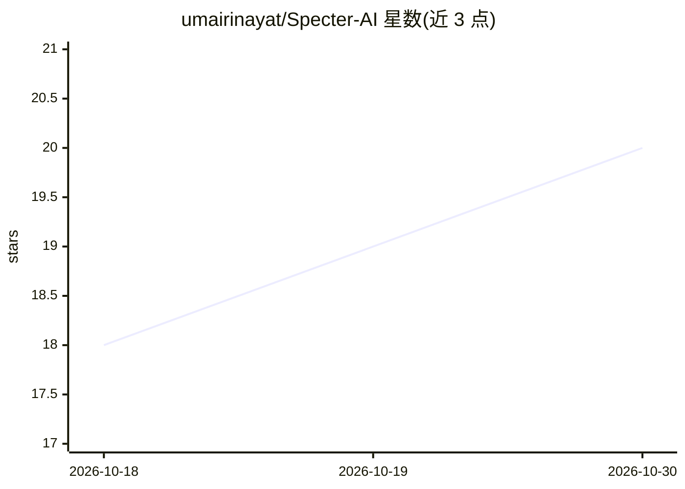

# umairinayat/Specter-AI

⭐ 20 · TypeScript · MIT · 推送 2026-09-29 · [GitHub](https://github.com/umairinayat/Specter-AI) · [官网](https://umairinayat.github.io/Specter-AI/) · 个人维护

**屏幕/会议 AI 副驾：不可见于共享的悬浮助手**

Electron + React + TypeScript 桌面应用：在屏幕上叠加对屏幕共享软件（Zoom/Meet/Teams）不可见的悬浮窗，通过 Tesseract.js OCR 读取屏幕文本、用可配置 Whisper 供应商（Groq/OpenAI/自定义端点）实时转录音频，将上下文发送至 OpenRouter（BYOK，500+ 模型）并流式返回回答；支持 Playbooks 上下文文档注入、全局快捷键、本地加密存储 API key。除触发的 AI 调用外处理均在本地。提供 Win/macOS/Linux 预编译安装包，也可 Node.js 18+ 源码构建；Linux 下 Wayland 共享排除不可靠。

## 筛选速览

| 维度 | 判定 | 备注 |
|---|---|---|
| AI 角色 | `ai-native` | 本体是模型或模型工具 |
| 许可风险 | `permissive` | MIT |
| 部署形态 | `desktop` | 安装包/桌面程序 |
| 模型依赖 | locked-api |  |
| 硬件要求 | — | 无带数字的原话,不猜 |
| 安装摩擦 | `low` | 无编译、无系统依赖或容器化 |
| 成熟度 | — | 结构信号不足 |

## 能力要点

- 悬浮窗对 Zoom/Meet/Teams 等共享软件不可见（macOS panel + Windows setContentProtection）
- Tesseract.js OCR 屏幕读取 + 每 10 秒音频转录（Groq/OpenAI/自定义 Whisper 端点）
- OpenRouter BYOK 接入 500+ 模型，流式响应并显示 token 与费用
- Playbooks 上下文文档自动注入每次 AI 请求

## 适用场景

- 会议或面试时私人在屏幕上获取 AI 辅助而不被共享者看到
- 上传会议准备、职位描述等文档作为上下文提问
- 录制麦克风并实时转录对话供 AI 引用

## 场景标签

`AI 助手` `语音识别` · 领域:对话与助手

## 证据(README 行号)

> L25: Specter AI is a desktop application that overlays AI-powered assistance on your screen during meetings, interviews,
> L28: - Sends context to any AI model on OpenRouter (500+ models including GPT-4, Claude, Gemini, Llama, DeepSeek)
> L52: - Powered by OpenRouter -- access 500+ AI models with one API key

## 星数曲线

2026-10-18 18 → 2026-10-30 20（+2）

---
*卡片 v1 · prompt 1.4 · 生成 2026-10-28 · 置信度 high · 依据 README sha `a01919bb089c` · [字段定义](../../DATASET.md)*
