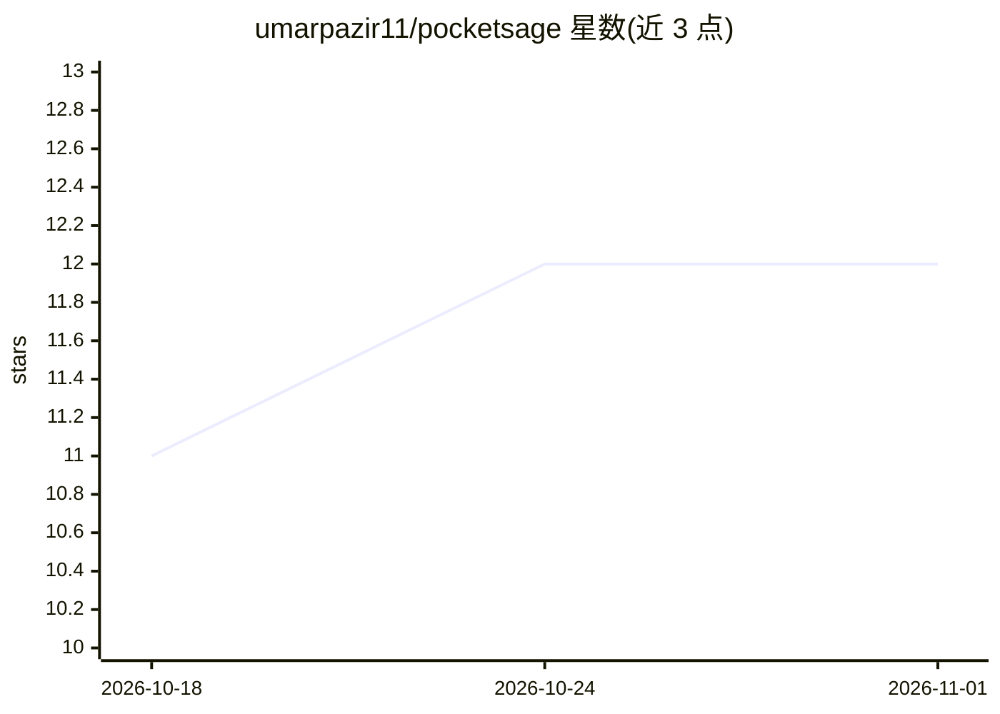

# umarpazir11/pocketsage

⭐ 12 · Kotlin · 推送 2026-05-08 · [GitHub](https://github.com/umarpazir11/pocketsage) · 个人维护

**Android 端全离线 PDF 问答应用：本地 RAG，数据不出手机**

面向 Android 用户的本地 RAG 应用：导入 PDF 后在设备端完成文本提取、分块、LiteRT MiniLM 384 维向量嵌入与 Top-K 余弦检索，并由 Gemma 4 E2B Instruct（.litertlm 格式，约 2.58 GB）经 LiteRT-LM 生成流式回答，UI 同时展示回答所用的原文片段。全程无需网络、API key 或遥测。模型不打包进 APK，首次启动通过 Storage Access Framework 导入。要求 Android 12+、4 GB+ RAM、约 3 GB 存储及真机（模拟器无硬件加速）；向量检索为暴力余弦搜索，适合数千级文档分块。以 Kotlin/Jetpack Compose 构建，提供 APK 与源码构建两种安装方式。

## 筛选速览

| 维度 | 判定 | 备注 |
|---|---|---|
| AI 角色 | `ai-native` | 本体是模型或模型工具 |
| 许可风险 | `permissive` | — |
| 部署形态 | `None` |  |
| 模型依赖 | — | README 未给出锁定关系 |
| 硬件要求 | — | 无带数字的原话,不猜 |
| 安装摩擦 | `low` | 无编译、无系统依赖或容器化 |
| 成熟度 | — | 结构信号不足 |

## 能力要点

- 设备端完整 RAG 流水线：PDF 解析、嵌入、余弦检索、流式生成
- 回答下方展示所用原文片段，可审计
- 无网络、无 API key、无遥测，模型隔离于应用私有存储
- 防御式编程：ModelGate 拦截、临时文件重命名、Session 生命周期管理

## 适用场景

- 在手机上对合同、财务等敏感 PDF 离线提问
- 数据合规要求下不将文档发送云端的企业场景
- 作为 Clean Architecture 结合端侧 LLM 推理的 Android 工程参考

## 场景标签

`文档问答` · 领域:知识与检索

## 证据(README 行号)

> L3: ### Fully offline, on-device RAG for Android.
> L24: - ⚡ **Streaming LLM** — Generate grounded, token-streamed responses using Gemma 4 E2B Instruct via LiteRT-LM.

## 星数曲线

2026-10-18 11 → 2026-11-01 12（+1）

---
*卡片 v1 · prompt 1.4 · 生成 2026-10-31 · 置信度 high · 依据 README sha `481dd84e6a1d` · [字段定义](../../DATASET.md)*
