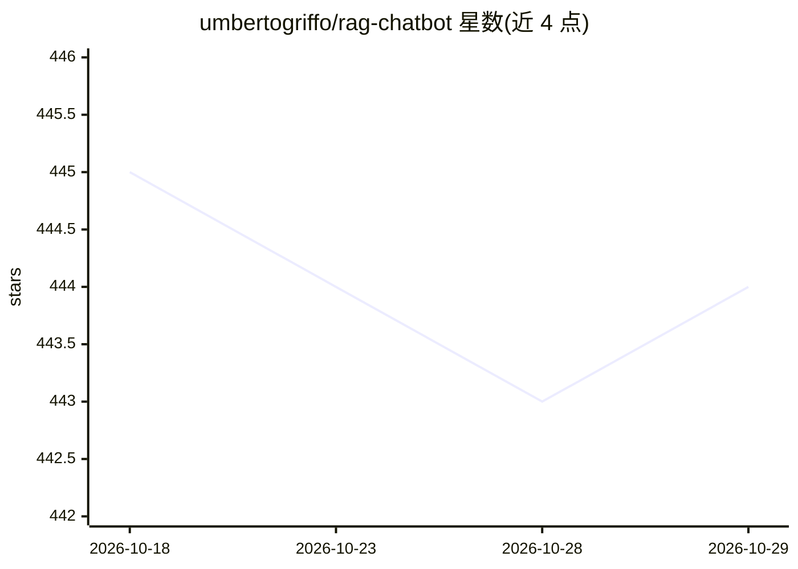

# umbertogriffo/rag-chatbot

⭐ 444 · Python · Apache-2.0 · 推送 2026-06-12 · [GitHub](https://github.com/umbertogriffo/rag-chatbot) · 个人维护

**基于本地 LLM 的 RAG 聊天机器人：用 Markdown 文档库回答提问**

结合 llama.cpp 与 Chroma 构建的对话式聊天机器人：Memory Builder 读取 docs 目录下 Markdown 文件分块，用 Sentence Transformers 模型计算嵌入存入 Chroma 向量库；提问时先用 LLM 改写问题再检索，以检索片段为上下文由本地 LLM 生成回答，并支持对话历史记忆。向量库按文档版本哈希增量更新，删除通过 SQLite 映射表定位。需 Python 3.12+、支持 CUDA 12.4+ 或 Apple Silicon 的 GPU，通过 Makefile/Docker Compose 部署，前端 Vite/React，后端 FastAPI。README 提示 LLM 可能产生幻觉。

## 筛选速览

| 维度 | 判定 | 备注 |
|---|---|---|
| AI 角色 | `ai-native` | 本体是模型或模型工具 |
| 许可风险 | `permissive` | Apache-2.0 |
| 部署形态 | `self-host` | docker 或自建部署 |
| 模型依赖 | local-ok | 支持本地模型 |
| 硬件要求 | — | 无带数字的原话,不猜 |
| 安装摩擦 | `low` | 无编译、无系统依赖或容器化 |
| 成熟度 | — | 结构信号不足 |

## 能力要点

- Markdown 文档分块嵌入 Chroma 向量库，问答带检索上下文
- 问题改写 + 两种响应合成策略（create-and-refine / tree-summarization）
- 向量库按文档版本哈希增量更新，SQLite 映射表处理删除
- 通过 Docker Compose 本地运行 llama.cpp server 加载 GGUF 模型

## 适用场景

- 把内部 Markdown 文档做成可问答的知识库聊天机器人
- 在本地 GPU 上离线运行 RAG 对话应用
- 在文档集上持续增量更新索引并提问

## 场景标签

`聊天机器人` `RAG` `文档问答` · 领域:对话与助手

## 证据(README 行号)

> L28: * a Conversation-aware Chatbot (ChatGPT like experience).
> L31: The RAG Chatbot works by taking a collection of Markdown files as input and, when asked a question, provides the
> L48: The most relevant sections are then used as context to generate the final answer using a local language model (LLM)

## 星数曲线

2026-10-18 445 → 2026-10-29 444（-1）

---
*卡片 v1 · prompt 1.4 · 生成 2026-10-21 · 置信度 mid · 依据 README sha `a8aab148136f` · [字段定义](../../DATASET.md)*
