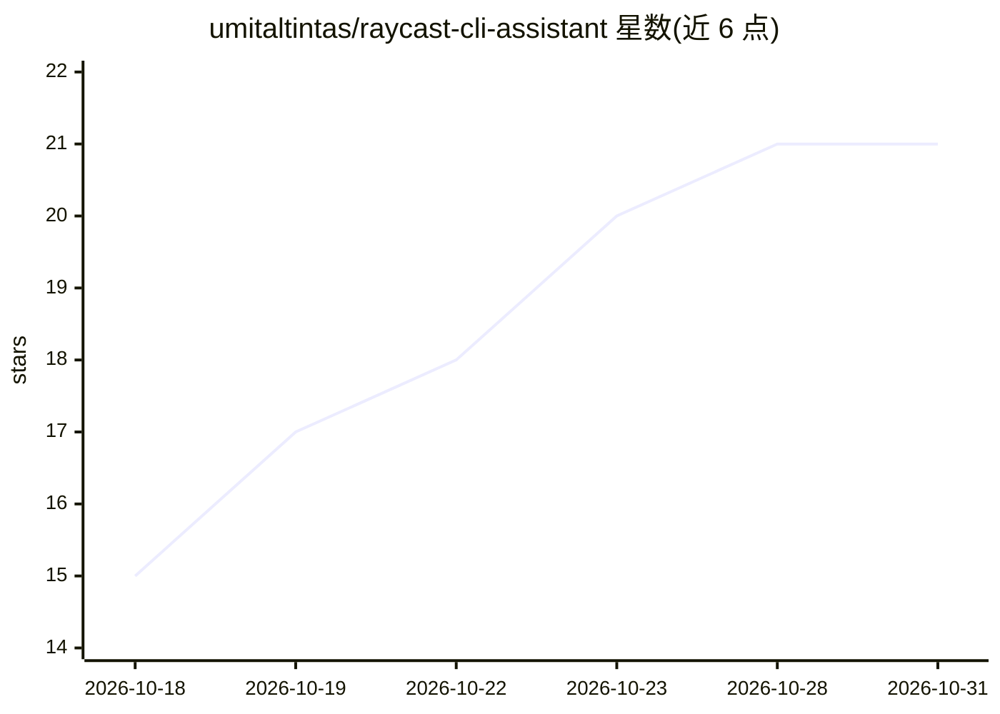

# umitaltintas/raycast-cli-assistant

⭐ 21 · TypeScript · MIT · 推送 2026-10-15 · [GitHub](https://github.com/umitaltintas/raycast-cli-assistant) · 个人维护

**让 Raycast 免 Pro 用 AI：经 Claude Code/Codex CLI 问答翻译改写**

Raycast 扩展，把用户的请求转发到本机已安装并登录的 Claude Code 或 Codex CLI，从而在已有 Claude/ChatGPT 订阅上获得 Raycast 的日常 AI 功能，无需 Raycast Pro、API key 或按 token 计费。功能包括根搜索提问、多轮聊天、翻译与原地改写选中文本、总结解释、对选中文件提问，可选 web 搜索与工具（读文件/跑 shell）。模型列表来自已装 CLI，可中途切换。通过关闭 CLI 的工具、MCP、设置文件与 agent 提示词来降低延迟与 token。macOS/Windows 均有安装脚本；Windows 工具与登录流程存在差异；Spotlight 应用仅限 macOS。

## 筛选速览

| 维度 | 判定 | 备注 |
|---|---|---|
| AI 角色 | `ai-native` | 本体是模型或模型工具 |
| 许可风险 | `permissive` | MIT |
| 部署形态 | `desktop` | 安装包/桌面程序 |
| 模型依赖 | locked-api |  |
| 硬件要求 | — | 无带数字的原话,不猜 |
| 安装摩擦 | `low` | 无编译、无系统依赖或容器化 |
| 成熟度 | — | 结构信号不足 |

## 能力要点

- 复用已有 Claude/ChatGPT 订阅的 CLI，无需 Raycast Pro 或 API key
- 翻译/改写选中文本、多轮聊天、对选中文件提问、总结解释
- 模型列表来自已安装 CLI，可中途切换（含跨 Claude/Codex）
- 关闭 CLI 的工具/MCP/agent 提示词以缩短首答时间与 token 用量

## 适用场景

- 已有 Claude 或 ChatGPT 订阅的用户想在 Raycast 里直接问 AI
- 选中文本一键翻译、润色或缩短并原地替换
- 对 Finder 选中的文件（PDF、日志、代码）提问
- 不开 Raycast 界面，通过 Spotlight 快速提问

## 场景标签

`AI 助手` · 领域:对话与助手

## 证据(README 行号)

> L7: Claude and ChatGPT plans include a coding CLI: Claude Code and Codex. This Raycast extension runs your requests thro
> L9: - **Ask AI** from root search, and **Chat** with follow-ups and history
> L11: - **Translate** as you type, or **Translate and Replace** the selection with one hotkey

## 星数曲线

2026-10-18 15 → 2026-10-31 21（+6）

---
*卡片 v1 · prompt 1.4 · 生成 2026-10-28 · 置信度 mid · 依据 README sha `ac2af3369a85` · [字段定义](../../DATASET.md)*
