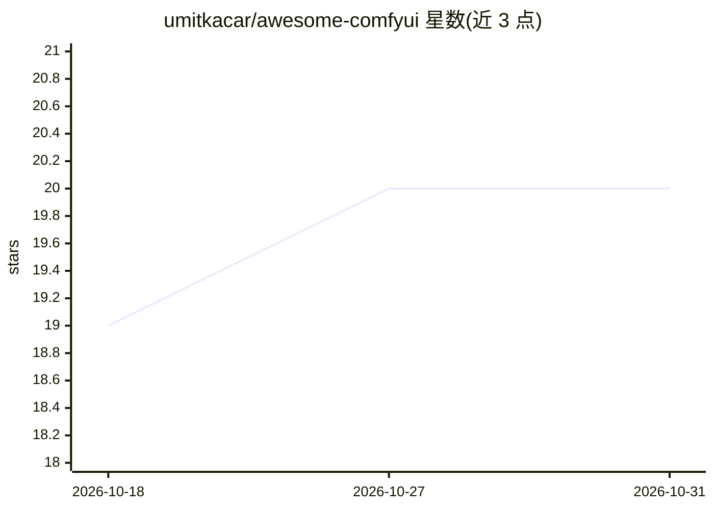

# umitkacar/awesome-comfyui

⭐ 20 · Python · MIT · 推送 2025-11-10 · [GitHub](https://github.com/umitkacar/awesome-comfyui) · 个人维护

**ComfyUI 生态资源策展清单：模型、节点与工作流工具收录**

由 umitkacar 个人维护的 ComfyUI 生态资源清单，覆盖视频生成（HunyuanVideo/LTX/Mochi/CogVideoX）、面部与肖像（PuLID/InstantID）、图像增强与背景移除（BiRefNet/SUPIR/IC-Light）、3D 生成（Trellis）及工作流工具等类别；条目以 GitHub 仓库链接形式给出，附功能要点、VRAM 要求与许可信息。面向使用 ComfyUI 进行图像/视频生成的创作者与开发者，内容更新至 2024 年 11 月。

## 筛选速览

| 维度 | 判定 | 备注 |
|---|---|---|
| AI 角色 | `ai-knowledge` | 知识聚合/清单类 |
| 许可风险 | `permissive` | MIT |
| 部署形态 | `None` |  |
| 模型依赖 | — | README 未给出锁定关系 |
| 硬件要求 | — | 无带数字的原话,不猜 |
| 安装摩擦 | `low` | 无编译、无系统依赖或容器化 |
| 成熟度 | — | 结构信号不足 |

## 能力要点

- 按视频生成、面部肖像、图像增强、3D 生成、工作流工具等类别组织条目
- 每个条目给出仓库链接、功能要点与 VRAM/许可信息
- 收录 2024-2025 新模型（HunyuanVideo、LTX Video、Flux.1、Trellis 等）
- 含首次设置指南与必装扩展（ComfyUI Manager、Workspace Manager）章节

## 适用场景

- 搭建 ComfyUI 环境时查找必装扩展与自定义节点
- 选型视频生成、换脸、背景移除、3D 生成模型时比对 VRAM 要求与许可
- 跟踪 ComfyUI 生态 2024-2025 的新模型与新工具

## 场景标签

`精选清单` `图像生成` `视频生成` · 领域:内容生成

## 证据(README 行号)

> L1: # 🚀 AWESOME COMFYUI BEYOND
> L13: **From cutting-edge video generation to 3D creation, this is your comprehensive guide to the ComfyUI ecosystem.**

## 星数曲线

2026-10-18 19 → 2026-10-31 20（+1）

---
*卡片 v1 · prompt 1.4 · 生成 2026-10-28 · 置信度 high · 依据 README sha `c30383284e4a` · [字段定义](../../DATASET.md)*
