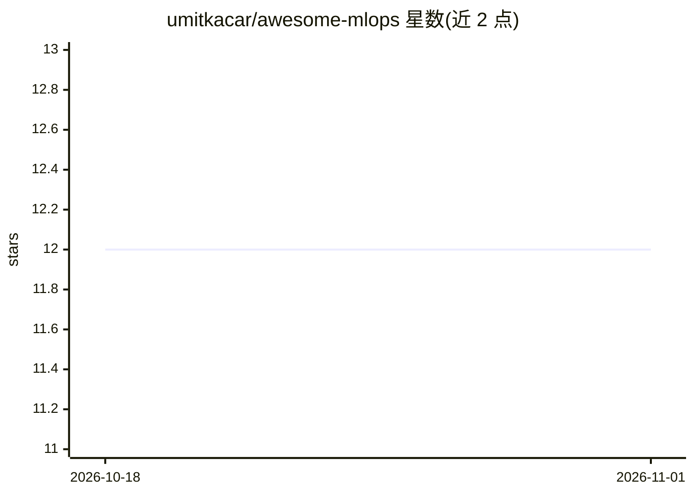

# umitkacar/awesome-mlops

⭐ 12 · Python · MIT · 推送 2025-11-10 · [GitHub](https://github.com/umitkacar/awesome-mlops) · 个人维护

**MLOps 工具生态策展清单：覆盖 ML 全生命周期的工具目录**

面向构建生产级机器学习系统的工具聚合清单：按 LLMOps/GenAI、数据标注、实验跟踪、模型服务、监控、工作流编排、特征存储、向量数据库、AutoML、边缘部署与 ML 安全等类别组织条目，每条含星数与简述，部分附带代码示例。目标读者为选型 MLOps 工具链的开发者与团队。仓库本身提供 git clone 与 pip 安装依赖的获取方式，并声明使用 Hatch/Ruff/uv 等工程工具。限制：条目为列举性介绍，非集成方案。

## 筛选速览

| 维度 | 判定 | 备注 |
|---|---|---|
| AI 角色 | `ai-knowledge` | 知识聚合/清单类 |
| 许可风险 | `permissive` | MIT |
| 部署形态 | `library` | 以包/库形式分发 |
| 模型依赖 | — | README 未给出锁定关系 |
| 硬件要求 | — | 无带数字的原话,不猜 |
| 安装摩擦 | `low` | 无编译、无系统依赖或容器化 |
| 成熟度 | — | 结构信号不足 |

## 能力要点

- 覆盖 LLMOps、实验跟踪、模型服务、监控、特征存储、向量数据库等十余个类别
- 收录 LangChain、vLLM、Ollama、MLflow、Feast、Airflow 等工具并附星数
- 部分类别附 Python 快速示例代码
- 声明使用 Hatch/Ruff/uv/pytest-xdist 等工程工具链

## 适用场景

- 为 ML 项目选型部署、监控与流水线工具
- 了解 2024-2025 年 MLOps 与 LLMOps 工具生态
- 按类别查找特征存储与向量数据库方案

## 场景标签

`精选清单` · 领域:学习与行业

## 证据(README 行号)

> L21: **MLOps Ecosystem 2024-2025** is your ultimate guide to building production-grade machine learning systems. This re
> L64: ### 🤖 LLMOps & GenAI (2024-2025)

## 星数曲线

2026-10-18 12 → 2026-11-01 12（+0）

---
*卡片 v1 · prompt 1.4 · 生成 2026-10-31 · 置信度 mid · 依据 README sha `b91435223bc6` · [字段定义](../../DATASET.md)*
