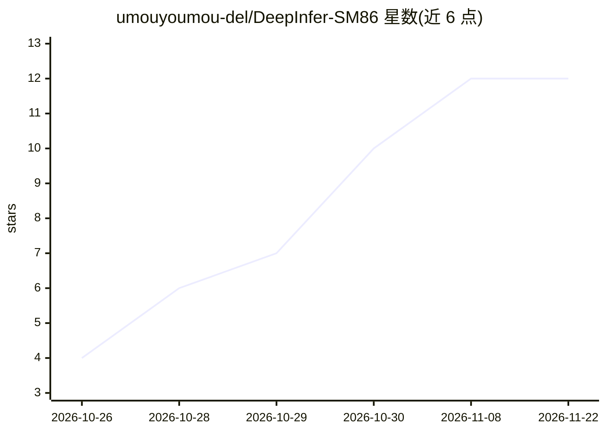

# umouyoumou-del/DeepInfer-SM86

⭐ 12 · Python · Apache-2.0 · 推送 2026-11-04 · [GitHub](https://github.com/umouyoumou-del/DeepInfer-SM86) · 个人维护 · 中文 README

**在 SM86 GPU 上以 CUDA kernel 本地运行 Qwen2.5/DeepSeek 的推理后端与 API 网关**

非官方扩展仓库，为 DeepInfer 增加面向 Qwen2.5/Llama/Mistral/Gemma dense decoder 与 DeepSeek-V2-Lite MoE 的原生 CUDA 推理后端，提供 W4A16/W3A16 量化 kernel、paged KV cache、连续批处理，以及最长数百万 token 的长上下文定位重读路径。附带本地 OpenAI 兼容网关与 CLI/server/bench 四个命令，通过安装脚本或 pip 部署，依赖 NVIDIA GPU 与 CUDA 12 驱动。

## 筛选速览

| 维度 | 判定 | 备注 |
|---|---|---|
| AI 角色 | `ai-ecosystem` | LLM/agent 周边工具 |
| 许可风险 | `permissive` | Apache-2.0 |
| 部署形态 | `desktop` | 安装包/桌面程序 |
| 模型依赖 | — | README 未给出锁定关系 |
| 硬件要求 | `gpu-8g` | |
| 安装摩擦 | `medium` | 含编译或系统依赖之一 |
| 成熟度 | — | 结构信号不足 |

## 能力要点

- SM86 上的 W4A16/W3A16 CUDA GEMV/GEMM 与 GQA decode kernel
- paged/elastic KV、prefix cache 与连续批处理调度
- DeepSeek-V2-Lite Q4_K_M GGUF routed-expert 流式 MoE 与 CPU/GPU offload
- 最长 4M token 的长上下文边读边问与定位重读机制

## 适用场景

- 在 4GB 显存笔记本 GPU 上本地运行 Qwen2.5-3B/7B 量化模型
- 本地启动 OpenAI 兼容 API 服务处理长文档问答
- 对 DeepSeek MoE 模型做量化推理与速度测试

## 场景标签

`模型量化` `推理引擎` · 领域:训练与推理

## 证据(README 行号)

> L5: 推理后端，并在其上提供 paged KV、连续批处理和指标治理等 engine-core 原型。
> L53: |`deepinfer-server`|网页 + API，上下文可到几百万 token，边读边问|`llama-server`|
> L121: 所有 CUDA kernel 走 CuPy 的 NVRTC，编译选项统一为

## 星数曲线

2026-10-26 4 → 2026-11-22 12（+8）

---
*卡片 v1 · prompt 1.4 · 生成 2026-11-18 · 置信度 high · 依据 README sha `67c104ac03e9` · [字段定义](../../DATASET.md)*
