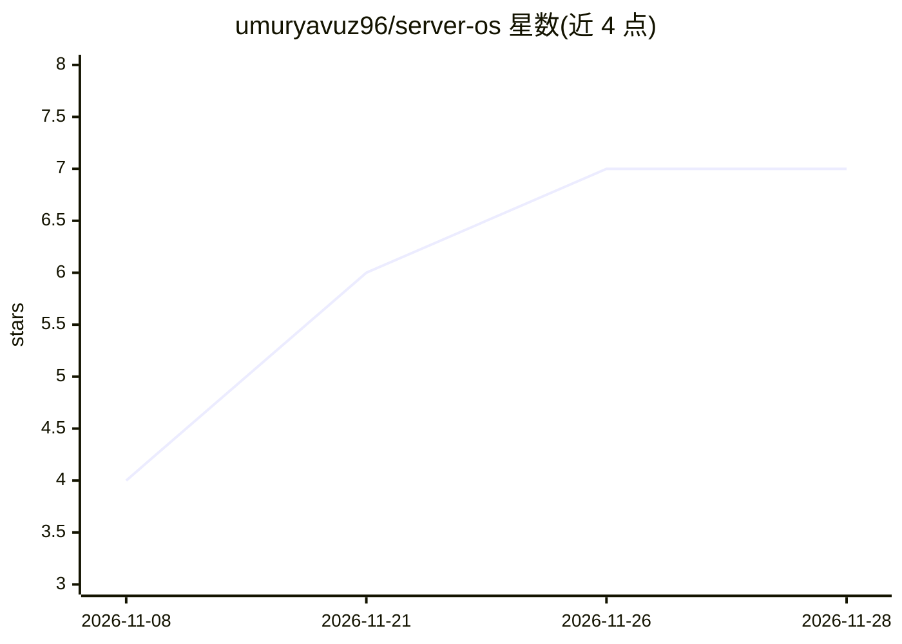

# umuryavuz96/server-os

⭐ 7 · TypeScript · MIT · 推送 2026-11-03 · [GitHub](https://github.com/umuryavuz96/server-os) · 个人维护

**自托管家庭服务器控制面板：macOS/Linux 主机监控、应用开关与 Claude Code agent 运维**

面向 Mac mini 与 Linux 主机的自托管面板：在一个 SSE 流内呈现 CPU/内存/磁盘/交换/网络实时指标、监听端口、结构化日志与告警；为 Docker Compose 应用、launchd 服务和 VM 提供带确认与审计的开/关操作，内置调度器支持 shell、Claude 提示词（claude -p）与 HTTP 检查任务。Agent 部分包括预配置的 Claude Code 根代理（9 个技能 + MCP server）、面板内管理的 tmux 机器人，以及基于 whisper.cpp 的服务端语音转写。提供 OpenAPI 3.1 描述的 /api/v1，iOS 应用尚未发布。macOS 为主要平台，Linux 为实验性。

## 筛选速览

| 维度 | 判定 | 备注 |
|---|---|---|
| AI 角色 | `ai-enhanced` | 去掉 AI 部分产品仍成立 |
| 许可风险 | `permissive` | MIT |
| 部署形态 | `self-host` | docker 或自建部署 |
| 模型依赖 | locked-api |  |
| 硬件要求 | — | 无带数字的原话,不猜 |
| 安装摩擦 | `low` | 无编译、无系统依赖或容器化 |
| 成熟度 | `idea` | |

## 能力要点

- 实时 vitals、端口、日志/trace 与"需关注"列表，单 SSE 流无轮询
- Docker/launchd/VM 应用的真实开关，带确认对话框与审计日志
- Claude Code 根代理（CLAUDE.md + 9 技能 + MCP server）与面板内 bot 管理
- 从 awesome-selfhosted、CasaOS、LinuxServer.io、Homebrew 检索并一键安装 1,600+ 自托管应用

## 适用场景

- 在 Mac mini/Linux 主机上集中监控和管理 Docker 应用与系统服务
- 让 Claude Code 代理安装应用、安排任务、诊断问题
- 通过 cron/Claude 提示词/HTTP 检查任务实现自动化与告警
- 用手机浏览器或配对的 iOS 设备查看面板并远程操作

## 场景标签

 · 领域:运维/自托管工具

## 证据(README 行号)

> L3: ### A self-hosted home server dashboard for macOS (Mac mini) and Linux, run with an AI agent.
> L19: - **An agent that does the chores.** A pre-instructed Claude Code session, on your own Claude subscription, install

## 星数曲线

2026-11-08 4 → 2026-11-28 7（+3）

---
*卡片 v1 · prompt 1.4 · 生成 2026-11-21 · 置信度 high · 依据 README sha `c5bdd53c3567` · [字段定义](../../DATASET.md)*
