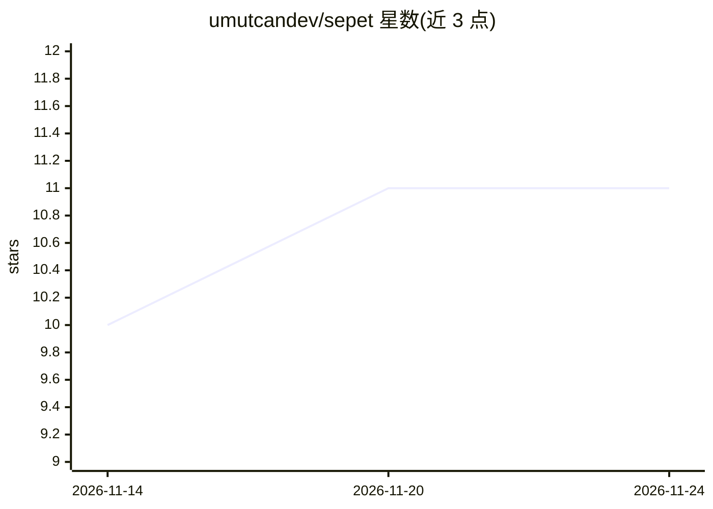

# umutcandev/sepet

⭐ 11 · TypeScript · MIT · 推送 2026-11-23 · [GitHub](https://github.com/umutcandev/sepet) · [官网](https://www.trysepet.com) · 个人维护

**AI 助手汇总土耳其连锁超市价格并优化购物车**

土耳其购物优化平台：用户用自然语言输入购物清单，或上传购物小票/餐食照片（OCR 视觉识别），系统将输入转为结构化条目、与实时超市目录匹配，给出满足全部条目的最便宜单店方案与分店购买的最优两店组合，并对比历史小票计算可量化的节省金额。前端 Next.js/React，AI 层经 Vercel AI SDK 调用 Claude，Gemini 作为备用模型；价格数据来自 marketfiyati.org.tr。

## 筛选速览

| 维度 | 判定 | 备注 |
|---|---|---|
| AI 角色 | `ai-native` | 本体是模型或模型工具 |
| 许可风险 | `permissive` | MIT |
| 部署形态 | `library` | 以包/库形式分发 |
| 模型依赖 | locked-api |  |
| 硬件要求 | — | 无带数字的原话,不猜 |
| 安装摩擦 | `low` | 无编译、无系统依赖或容器化 |
| 成熟度 | — | 结构信号不足 |

## 能力要点

- 自然语言/小票照片/餐食照片三种输入方式
- 输出最便宜单店与最优两店组合两种方案
- 小票与当日最优价对比得出节省金额
- Claude 为主模型，Gemini 2.5 Flash 为备用与语音入口

## 适用场景

- 比较土耳其连锁超市实时价格省下购物支出
- 拍下小票看看同样的东西今天买更便宜多少
- 输入一份菜名清单让 AI 算出最划算的购买组合

## 场景标签

`OCR` · 领域:感知与多模态

## 证据(README 行号)

> L25: **Sepet**, Türkiye'deki zincir marketlerin canlı fiyatlarını tek bir yapay zekâ asistanı arkasına toplayan bir alış
> L39: |Yapay zekâ|Vercel AI SDK 6, Claude Haiku 5.5 (yedek: Gemini 2.5 Flash)|

## 星数曲线

2026-11-14 10 → 2026-11-24 11（+1）

---
*卡片 v1 · prompt 1.4 · 生成 2026-11-19 · 置信度 high · 依据 README sha `89ecb6a341ce` · [字段定义](../../DATASET.md)*
