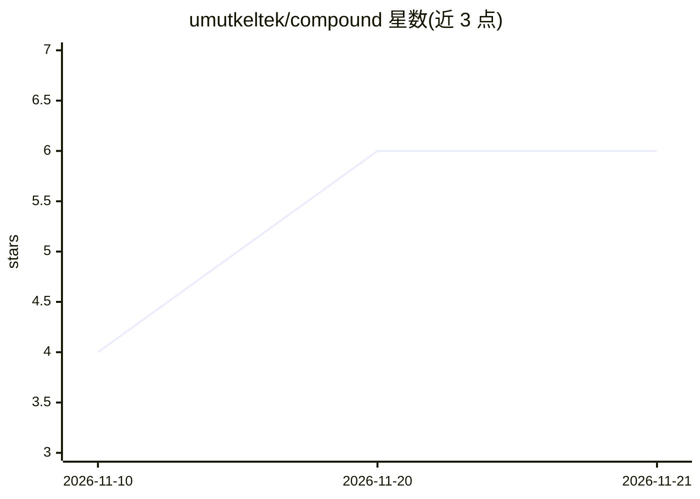

# umutkeltek/compound

⭐ 6 · Go · Apache-2.0 · 推送 2026-11-20 · [GitHub](https://github.com/umutkeltek/compound) · 个人维护

**为编码 agent 会话留下可复用结构记忆的本地工具**

Compound 是一个本地运行的 CLI 工具，通过 `compound init` 向 Claude Code、Codex 等编码 agent 的 harness 写入 hook：会话开始时提供任务简报，过程中记录每次工具调用作为证据，会话结束时生成回执。跨会话工作以 work item 形式留存，全部状态存于 `~/.compound` 纯文本文件，无账户与服务器。当前为 public alpha，仅支持单用户单机；OpenCode 无会话结束事件故无回执，oh-my-pi hook 可按策略阻止工具调用。

## 筛选速览

| 维度 | 判定 | 备注 |
|---|---|---|
| AI 角色 | `ai-ecosystem` | LLM/agent 周边工具 |
| 许可风险 | `permissive` | Apache-2.0 |
| 部署形态 | `None` |  |
| 模型依赖 | — | README 未给出锁定关系 |
| 硬件要求 | — | 无带数字的原话,不猜 |
| 安装摩擦 | `medium` | 含编译或系统依赖之一 |
| 成熟度 | `idea` | |

## 能力要点

- 通过 hook 机制为 Claude Code/Codex 会话生成简报、证据记录与会话回执
- 全部状态保存为 `~/.compound` 下的本地纯文件，无云服务与账户
- 支持 work item 跨会话接续任务，提供 workbench/doctor/home backup 等日常命令
- 可选只读 dashboard，需源码 checkout、Bun 与 Node 20+

## 适用场景

- 让编码 agent 在新会话中延续昨天记录的决策与目标
- 留存每次 agent 会话做了什么的回执记录
- 跨多个会话跟踪同一个任务直到完成

## 场景标签

`编码 Agent` `Agent 记忆` · 领域:Agent 开发

## 证据(README 行号)

> L36: - `compound init` looked for each supported coding agent (Compound calls it a *harness*) and wired
> L71: - **Not an agent.** Your harness does the work. Compound gives it context and keeps the record.
> L75: Your harness calls Compound at fixed points in each session, through the hooks `compound init`

## 星数曲线

2026-11-10 4 → 2026-11-21 6（+2）

---
*卡片 v1 · prompt 1.4 · 生成 2026-11-20 · 置信度 high · 依据 README sha `78ba81ff5710` · [字段定义](../../DATASET.md)*
