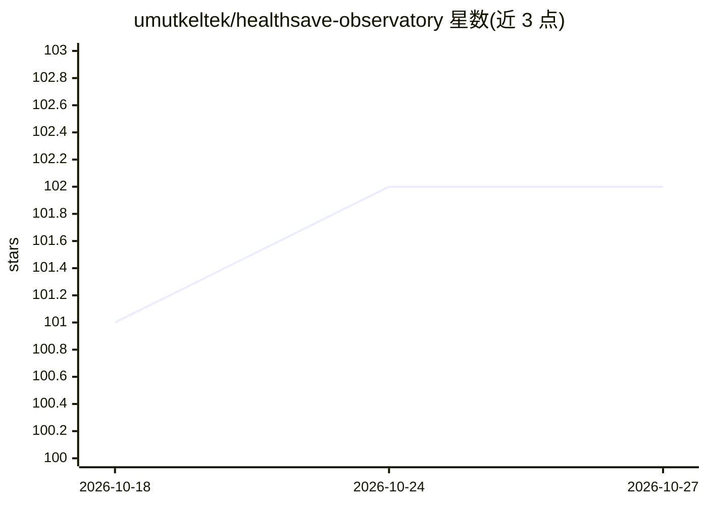

# umutkeltek/healthsave-observatory

⭐ 102 · Python · NOASSERTION · 推送 2026-10-22 · [GitHub](https://github.com/umutkeltek/healthsave-observatory) · [官网](https://healthsave.app/for/self-hosters/) · 个人维护

**自托管健康数据观测台：聚合 Apple Health/穿戴设备数据并提供本地 AI 解读**

HealthSave iOS 应用的自托管后端：通过 HealthSave iOS 同步 Apple Health 数据，配合 Whoop/Amazfit 插件与 Garmin/Samsung 导入器，将数据写入自托管 TimescaleDB 的统一记录模型。提供 Web 界面、Grafana 仪表盘、FastAPI 私有 API、Home Assistant/MQTT 路由。统计层计算异常、趋势与相关性，可选的本地 AI（Ollama）对结果做叙述式解读；原始数据默认不出主机，云端叙述为可选且仅限派生结果。macOS/Linux/WSL2 需 Docker Compose v2，Elastic 2.0 源码可用许可。

## 筛选速览

| 维度 | 判定 | 备注 |
|---|---|---|
| AI 角色 | `ai-enhanced` | 去掉 AI 部分产品仍成立 |
| 许可风险 | `none` | NOASSERTION |
| 部署形态 | `self-host` | docker 或自建部署 |
| 模型依赖 | local-ok | 支持本地模型 |
| 硬件要求 | — | 无带数字的原话,不猜 |
| 安装摩擦 | `low` | 无编译、无系统依赖或容器化 |
| 成熟度 | `idea` | |

## 能力要点

- Apple Health/穿戴设备多源数据写入自托管 TimescaleDB 统一记录
- 可选本地 Ollama AI 对统计结果做叙述式解读（Interpreted locally 标识）
- 默认拒绝出站的隐私策略与出站台账，仅派生结果可离开主机
- 捆绑 Grafana 仪表盘、FastAPI API（60 条路由）与 Home Assistant/MQTT 桥接

## 适用场景

- 把 Apple Health 与穿戴设备数据集中到自己的服务器上管理
- 在家里或 NAS 上搭建健康数据观测台并用 Grafana 做仪表盘
- 让本地 AI 生成每周健康数据简报而不上传原始记录
- 把健康信号接入 Home Assistant 做自动化

## 场景标签

`数据分析` · 领域:效率与自动化

## 证据(README 行号)

> L11: HealthSave Observatory is the self-hosted backend for HealthSave. The iOS app can export and sync Apple Health data
> L32: **Findings.** Statistics compute anomalies, trends and correlations; the local AI *narrates* them on Ollama and is 
> L111: - **Evidence-linked findings.** Statistics compute anomalies, trends, summaries, and correlations. Local AI can na

## 星数曲线

2026-10-18 101 → 2026-10-27 102（+1）

---
*卡片 v1 · prompt 1.4 · 生成 2026-10-23 · 置信度 high · 依据 README sha `05a617e8fffa` · [字段定义](../../DATASET.md)*
