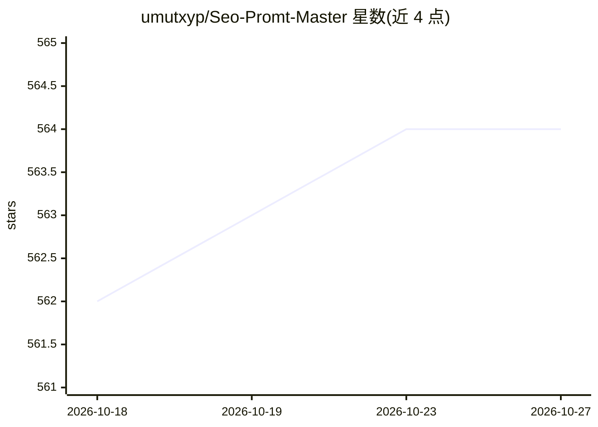

# umutxyp/Seo-Promt-Master

⭐ 564 · JavaScript · MIT · 推送 2026-10-17 · [GitHub](https://github.com/umutxyp/Seo-Promt-Master) · 个人维护

**面向编码 Agent 的 SEO/GEO 审计技能、提示词库与工具集**

一个仓库内含四部分：基于 Google Search Central 及 Bing/Yandex/Apple 等官方文档的引证式知识库（docs/01–18）、可安装进 Claude Code、Codex、Cursor、Gemini CLI、Copilot 等编码代理的技能（install.sh 写入各代理的发现文件）、47 条复制粘贴式提示词（8 类），以及两个零依赖可运行工具：seo-audit.mjs（Node 18+，抓取 sitemap 逐页审计，输出 0–100 的 SEO/GEO 分数与逐类明细）和部署冒烟脚本（依赖 curl/awk）。明确声明不测内容质量、外链与真实 Core Web Vitals。给需要在 CI 或代理工作流中做技术 SEO 审计的开发者使用。

## 筛选速览

| 维度 | 判定 | 备注 |
|---|---|---|
| AI 角色 | `ai-ecosystem` | LLM/agent 周边工具 |
| 许可风险 | `permissive` | MIT |
| 部署形态 | `library` | 以包/库形式分发 |
| 模型依赖 | — | README 未给出锁定关系 |
| 硬件要求 | — | 无带数字的原话,不猜 |
| 安装摩擦 | `low` | 无编译、无系统依赖或容器化 |
| 成熟度 | — | 结构信号不足 |

## 能力要点

- install.sh 一键将技能写入 Claude Code/Codex/Cursor/Gemini CLI/Copilot 各自的发现文件
- seo-audit.mjs 零依赖审计站点并输出带逐类明细的 SEO/GEO 分数，可作 CI 门禁
- 知识库每条声明引证官方文档，覆盖 Bing/Yandex/Apple 及 16 类 AI 爬虫
- 47 条提示词覆盖 robots.txt、hreflang、JSON-LD、流量诊断等 8 类任务

## 适用场景

- 让 Cursor/Claude Code 等编码代理直接执行站点的 SEO 审计与修复
- 在 CI 中用审计工具或冒烟脚本拦截软 404、robots 屏蔽等 P1 问题
- 查阅带官方引证的多搜索引擎与 AI 爬虫规则参考

## 场景标签

`提示工程` · 领域:Agent 开发

## 证据(README 行号)

> L5: **Install it into your project, and every coding agent you use — Claude Code, Codex, Cursor, Gemini CLI, Copilot — g
> L32: 2. **A skill** that installs into whichever agent you use, so "audit my SEO" starts the whole workflow without you 
> L40: ```bash

## 星数曲线



2026-10-18 562 → 2026-10-27 564（+2）


---
*卡片 v1 · prompt 1.4 · 生成 2026-10-22 · 置信度 high · 依据 README sha `b055b695799a` · [字段定义](../../DATASET.md)*
