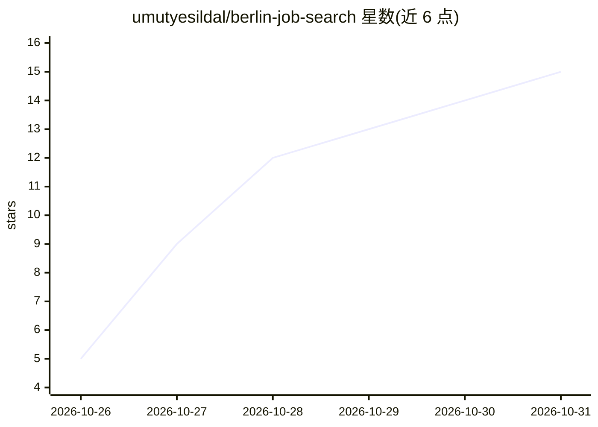

# umutyesildal/berlin-job-search

⭐ 15 · Python · MIT · 推送 2026-10-30 · [GitHub](https://github.com/umutyesildal/berlin-job-search) · [官网](https://github.com/umutyesildal/berlin-job-search) · 个人维护

**面向德国（柏林优先）求职者的 AI 求职教练技能包**

一个安装到 AI agent（Claude Code、Codex、Cursor、Gemini CLI、OpenCode、ChatGPT）里的求职技能：接入 Bundesagentur、Arbeitnow、LinkedIn、33 个公司招聘板等公开数据源做双语职位搜索与筛选，核查德语要求、2026 年蓝卡薪资门槛、签证路径，生成德式 Lebenslauf/英文 CV 与求职信并做 ATS 检查，提供德/英语模拟面试与申请跟踪仪表盘。结果以 Markdown 保存在本地 job-search/ 目录，无需 API key，不自动发送申请。

## 筛选速览

| 维度 | 判定 | 备注 |
|---|---|---|
| AI 角色 | `ai-ecosystem` | LLM/agent 周边工具 |
| 许可风险 | `permissive` | MIT |
| 部署形态 | `library` | 以包/库形式分发 |
| 模型依赖 | locked-api |  |
| 硬件要求 | — | 无带数字的原话,不猜 |
| 安装摩擦 | `low` | 无编译、无系统依赖或容器化 |
| 成熟度 | — | 结构信号不足 |

## 能力要点

- 聚合德国多个公开职位数据源的双语搜索与筛选
- 核查德语要求（引用原文）、蓝卡薪资门槛与签证路径
- 生成 Lebenslauf/CV 与求职信并做 PDF 渲染和 ATS 检查
- CV 与跟踪数据保留在本地，不外发

## 适用场景

- 在德国找工作的英语/外语使用者筛选招聘信息并核查语言与签证要求
- 准备德式简历、求职信并练习德语或英语面试
- 跟踪求职申请进度和回复率

## 场景标签

`AI 写作` · 领域:内容生成

## 证据(README 行号)

> L20: This skill gives your AI agent that knowledge, plus live job data and tools that do the
> L31: **Any agent** (Codex, Cursor, Gemini CLI, OpenCode, …)
> L33: npx skills add umutyesildal/berlin-job-search

## 星数曲线

2026-10-26 5 → 2026-10-31 15（+10）

---
*卡片 v1 · prompt 1.4 · 生成 2026-10-30 · 置信度 mid · 依据 README sha `54cb6f694a0a` · [字段定义](../../DATASET.md)*
