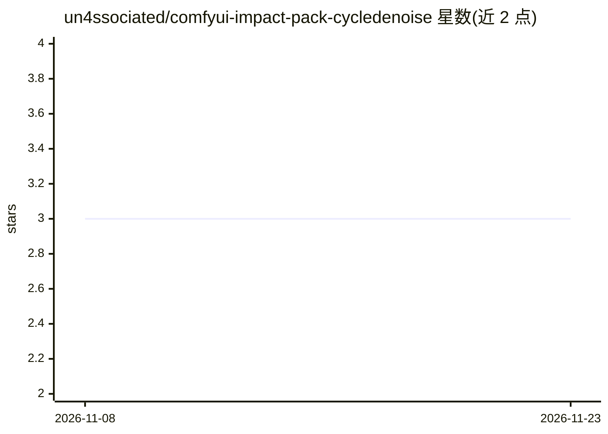

# un4ssociated/comfyui-impact-pack-cycledenoise

⭐ 3 · Python · GPL-3.0 · 推送 2026-11-03 · [GitHub](https://github.com/un4ssociated/comfyui-impact-pack-cycledenoise) · 个人维护

**ComfyUI 扩展节点：FaceDetailer 逐轮 denoise 与色彩匹配**

一个 ComfyUI 自定义节点，扩展 Impact Pack 的 FaceDetailer：将每轮 cycle 共用一个 denoise 改为最多 10 轮各自独立设置（denoise_pass_1…10），并支持在回贴前对重生成的脸部裁剪做颜色/亮度匹配（mean_std、histogram、Lab 等五种模式），消除高 denoise 下的色差接缝。其余检测、裁剪、SAM 细化行为与上游 FaceDetailer 一致。强制依赖 ComfyUI Impact Pack（测试于 8.30），随上游接口变动可能失效，不适用于视频。

## 筛选速览

| 维度 | 判定 | 备注 |
|---|---|---|
| AI 角色 | `ai-native` | 本体是模型或模型工具 |
| 许可风险 | `viral` | GPL-3.0 |
| 部署形态 | `None` |  |
| 模型依赖 | — | README 未给出锁定关系 |
| 硬件要求 | — | 无带数字的原话,不猜 |
| 安装摩擦 | `low` | 无编译、无系统依赖或容器化 |
| 成熟度 | — | 结构信号不足 |

## 能力要点

- 每轮 cycle 独立 denoise 值（最多 10 轮，绝对值 0.0001–1.0）
- 五种颜色匹配模式（mean_std/histogram/Lab 等）与强度混合控制
- 通过 DetailerHook 与 Impact Pack 内部钩子链集成，输出与原 FaceDetailer 一致

## 适用场景

- 高 denoise 修复破损人脸后低 denoise 保留面部特征
- 去除重生脸部回贴时的亮度/颜色接缝
- 分阶段渐进细化生成图像的面部细节

## 场景标签

`图像生成` · 领域:内容生成

## 证据(README 行号)

> L3: A ComfyUI custom node that extends
> L44: This node imports Impact Pack's internals (`modules.impact.hooks`, `modules.impact.impact_pack`).

## 星数曲线

2026-11-08 3 → 2026-11-23 3（+0）

---
*卡片 v1 · prompt 1.4 · 生成 2026-11-21 · 置信度 high · 依据 README sha `44a3b1a517ac` · [字段定义](../../DATASET.md)*
