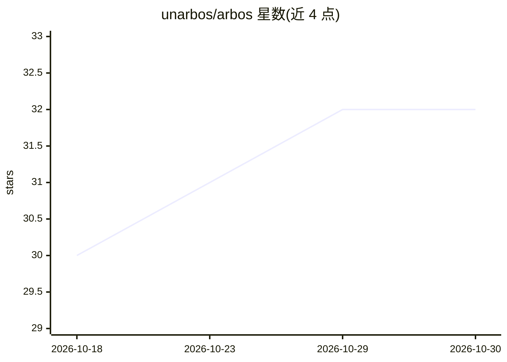

# unarbos/arbos

⭐ 32 · Rust · 推送 2026-10-29 · [GitHub](https://github.com/unarbos/arbos) · [官网](https://arbos.life) · 个人维护

**自托管的 AI agent 工作台：Mac/iPhone/终端与项目 agent 对话协作**

Arbos 是面向单用户的 AI agent 协作平台，自称可自托管的 Grokbot 克隆。用户在 Mac、iPhone 或终端中与项目 agent 对话，agent 在用户的云沙箱机器（Daytona，每用户一机）上执行工作：回答、少量工具调用，或将较大任务交给后台 subagent（Prime Agent、pi 或 Claude Code）并回报结果。架构含中继服务（登录、计费、密钥保管）、机器守护进程（每项目隔离工作区）、Loro CRDT 多端同步聊天。提供审批卡片、语音通话、连接器（Gmail/Slack/GitHub）、定时例程、技能、Slack/Telegram 等频道接入与密钥保管库等功能，也可通过 arbos.life 托管使用。

## 筛选速览

| 维度 | 判定 | 备注 |
|---|---|---|
| AI 角色 | `ai-native` | 本体是模型或模型工具 |
| 许可风险 | `none` | — |
| 部署形态 | `library` | 以包/库形式分发 |
| 模型依赖 | — | README 未给出锁定关系 |
| 硬件要求 | — | 无带数字的原话,不猜 |
| 安装摩擦 | `medium` | 含编译或系统依赖之一 |
| 成熟度 | — | 结构信号不足 |

## 能力要点

- 每用户一台云沙箱机器，每项目独立工作区（Unix 用户、cgroup、SQLite 记忆/历史隔离）
- subagent 机制：主 agent pi 通过 route 分派，默认 Prime Agent，可选 pi 或 Claude Code
- 风险操作（外发消息、vault、本地命令、破坏性 shell）需审批卡片并留审计记录
- Mac（DMG 签名公证）、iPhone（TestFlight）、arbosctl 终端与自托管四种使用途径

## 适用场景

- 用聊天方式让 agent 在自己的云机器上完成项目工作
- 在手机和电脑间无缝继续与同一个项目 agent 的对话
- 把 agent 接入 Slack/Telegram/WhatsApp，用定时例程在离线时执行任务

## 场景标签

`多智能体` `编码 Agent` `AI 助手` · 领域:Agent 开发

## 证据(README 行号)

> L15: Arbos is a messenger for working with AI agents. You talk to a project agent in a chat — on the Mac, on the iPhone,
> L42: - **Harness**: the main agent is **pi** with the `arbos-pi-ext` extension; every turn starts with a `route` call (`

## 星数曲线

2026-10-18 30 → 2026-10-30 32（+2）

---
*卡片 v1 · prompt 1.4 · 生成 2026-10-26 · 置信度 mid · 依据 README sha `5a2da5b3fe6f` · [字段定义](../../DATASET.md)*
