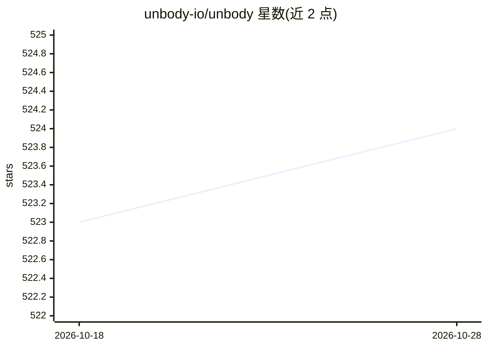

# unbody-io/unbody

⭐ 524 · TypeScript · Apache-2.0 · 推送 2026-04-14 · [GitHub](https://github.com/unbody-io/unbody) · [官网](https://unbody.io) · 组织维护

**构建 AI 原生软件的模块化开源后端（已归档，未维护）**

Unbody 是面向 AI 原生软件的开源模块化后端，自称 'AI 时代的 Supabase'，面向知识而非静态数据设计，涵盖数据摄取、ETL、知识库与 RAG 相关主题。仓库现已归档、不再活跃维护，开发重心转移至 Unbody Labs 下的 Adapt（轻量 provider 无关的 AI 记忆与学习框架）。原安装流程需 Node.js LTS、Docker Compose、yarn 与 OpenAI API key，通过 git clone 与 docker compose 运行，使用 Temporal dashboard 监控索引进度。

## 筛选速览

| 维度 | 判定 | 备注 |
|---|---|---|
| AI 角色 | `ai-ecosystem` | LLM/agent 周边工具 |
| 许可风险 | `permissive` | Apache-2.0 |
| 部署形态 | `self-host` | docker 或自建部署 |
| 模型依赖 | — | README 未给出锁定关系 |
| 硬件要求 | — | 无带数字的原话,不猜 |
| 安装摩擦 | `low` | 无编译、无系统依赖或容器化 |
| 成熟度 | — | 结构信号不足 |

## 能力要点

- 模块化后端，面向知识与 AI 原生软件构建
- 数据摄取与索引流程，经 Temporal dashboard 监控
- 提供 unbody-cli 添加数据源与示例仓库

## 适用场景

- 构建知识库型 AI 后端（原用途，现已归档）
- 参考其数据摄取与索引架构
- 迁移至后续项目 Adapt（AI 记忆与学习框架）

## 场景标签

`RAG` · 领域:知识与检索

## 证据(README 行号)

> L5: Unbody started as an open-source project to build the Supabase of the AI era. That vision has evolved.
> L7: We now build under **Unbody Labs** — shipping focused tools and products for the AI world. Our most active and direc

## 星数曲线

2026-10-18 523 → 2026-10-28 524（+1）

---
*卡片 v1 · prompt 1.4 · 生成 2026-10-21 · 置信度 high · 依据 README sha `adf72f4fb1dc` · [字段定义](../../DATASET.md)*
