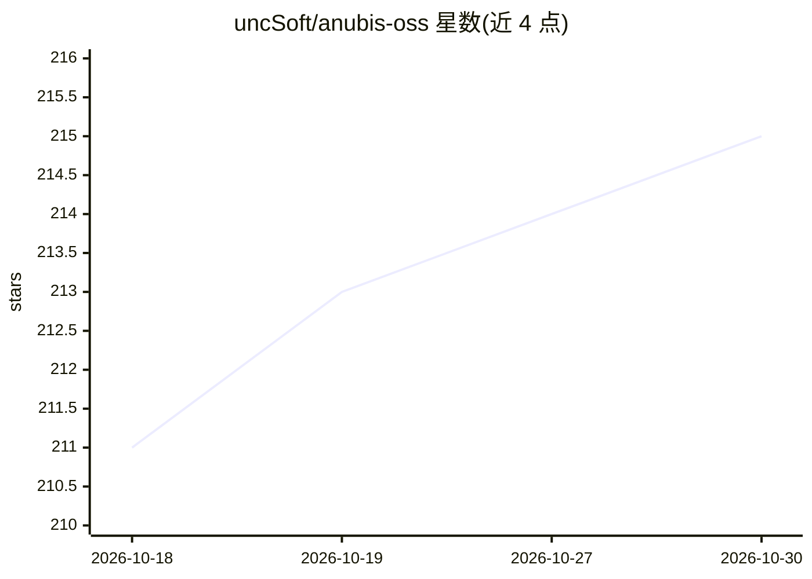

# uncSoft/anubis-oss

⭐ 215 · Swift · GPL-3.0 · 推送 2026-09-05 · [GitHub](https://github.com/uncSoft/anubis-oss) · [官网](https://devpadapp.com/leaderboard.html) · 组织维护

**macOS 本地 LLM 基准测试与模型管理应用（Apple Silicon）**

SwiftUI 编写的 macOS 原生应用，面向 Apple Silicon 用户，通过任意 OpenAI 兼容端点（Ollama、MLX、LM Studio Server、OpenWebUI 等）对本地大模型做基准测试、对比与管理。核心机制：推理性能与实时硬件遥测关联、N 次重复取均值与 95% 置信区间、服务器侧验证的 tok/s 与 TTFT 口径、Flow Builder 拖拽编排多模型多提示词的批量测试、应用内浏览与拉取 Ollama 模型、历史记录导出 .MD/.CSV 及社区排行榜提交。要求 macOS 15+，GPL-3.0 许可。

## 筛选速览

| 维度 | 判定 | 备注 |
|---|---|---|
| AI 角色 | `ai-ecosystem` | LLM/agent 周边工具 |
| 许可风险 | `viral` | GPL-3.0 |
| 部署形态 | `desktop` | 安装包/桌面程序 |
| 模型依赖 | local-ok | 支持本地模型 |
| 硬件要求 | — | 无带数字的原话,不猜 |
| 安装摩擦 | `low` | 无编译、无系统依赖或容器化 |
| 成熟度 | — | 结构信号不足 |

## 能力要点

- 推理性能与实时硬件遥测（CPU/GPU/ANE/DRAM 功耗）关联测量
- N-Rep 分组给出 mean ± 95% bootstrap CI 与显著性口径修正
- Flow Builder 拖拽编排多模型/多提示词/N 次重复的基准流程，导出分享卡片
- 应用内浏览 ollama.com/library、拉取模型并直接跑基准

## 适用场景

- 在 Mac 上对比不同模型/量化版本的本机推理速度与功耗
- 检测同一模型在同后端下的性能回归
- 批量编排多模型基准并生成可分享报告

## 场景标签

`模型评测` · 领域:评测与运维

## 证据(README 行号)

> L9: **Local LLM Testing & Benchmarking for Apple Silicon** | Community Leaderboard
> L19: Anubis is a native macOS app for benchmarking, comparing, and managing local large language models using any OpenAI

## 星数曲线

2026-10-18 211 → 2026-10-30 215（+4）

---
*卡片 v1 · prompt 1.4 · 生成 2026-10-22 · 置信度 mid · 依据 README sha `d4d81f0ae597` · [字段定义](../../DATASET.md)*
