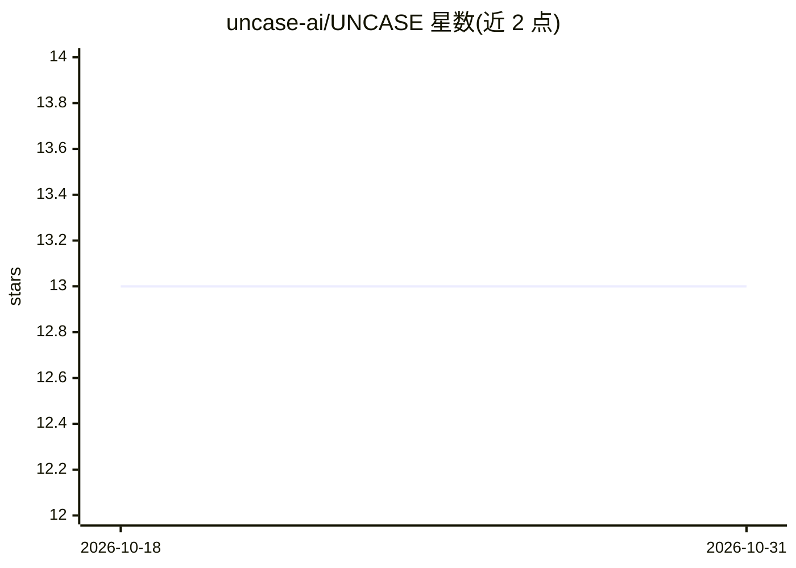

# uncase-ai/UNCASE

⭐ 13 · Python · 推送 2026-03-24 · [GitHub](https://github.com/uncase-ai/UNCASE) · [官网](https://uncase.md) · 组织维护

**面向受监管行业的 PII 无关合成对话数据与 LoRA 微调框架**

为医疗、金融、法律等受监管行业的 LLM 微调提供合成数据流水线：从不含真实数据的结构化 seed 生成合成对话，经 9 项硬门限质量指标评估，并将评估结果哈希后锚定到 Polygon PoS 链上供审计方独立核验。内置 Presidio NER、SpaCy 等隐私拦截层，LLM 网关可路由到 Claude、GPT-4、Gemini、Groq、Ollama、vLLM。支持 LoRA/QLoRA 微调（含 DP-SGD）、10+ 导出格式、30 个领域工具与 MCP server。以 Docker Compose（API+PostgreSQL+Redis+Dashboard）或 pip 库形式安装，本地开发需 Python 3.11+ 与 PostgreSQL 16+。

## 筛选速览

| 维度 | 判定 | 备注 |
|---|---|---|
| AI 角色 | `ai-ecosystem` | LLM/agent 周边工具 |
| 许可风险 | `none` | — |
| 部署形态 | `self-host` | docker 或自建部署 |
| 模型依赖 | local-ok | 支持本地模型 |
| 硬件要求 | — | 无带数字的原话,不猜 |
| 安装摩擦 | `low` | 无编译、无系统依赖或容器化 |
| 成熟度 | — | 结构信号不足 |

## 能力要点

- 从零真实数据的 seed 生成合成对话训练数据，PII 零容忍拦截
- 9 项硬门限质量指标（ROUGE-L、事实保真、隐私、记忆化等）
- 评估结果 SHA-256 哈希构建 Merkle 树锚定 Polygon PoS，可经 Polygonscan 核验
- LoRA/QLoRA 微调流水线，DP-SGD（epsilon ≤ 8.0）

## 适用场景

- 医疗/金融/法律机构在不接触真实 PII/PHI 数据的前提下微调专用 LLM
- 为合规审计提供链上可独立核验的数据质量证明
- 为 Claude Code 等 MCP 兼容 agent 暴露领域工具

## 场景标签

`微调` · 领域:训练与推理

## 证据(README 行号)

> L15: **UNCASE solves this.** It generates high-quality synthetic training data from structured *seeds* (conversation blu
> L19:   → Synthetic Generation → Re-evaluate → Blockchain Anchor → LoRA/QLoRA Fine-tune
> L76: |**Generation**|LLM Gateway|Route to Claude, GPT-4, Gemini, Groq, Ollama, vLLM — privacy-intercepted|

## 星数曲线

2026-10-18 13 → 2026-10-31 13（+0）

---
*卡片 v1 · prompt 1.4 · 生成 2026-10-31 · 置信度 high · 依据 README sha `7913aa36db5e` · [字段定义](../../DATASET.md)*
