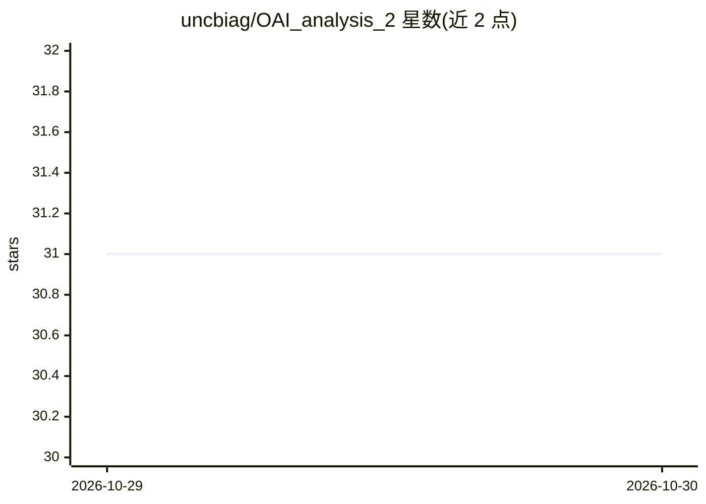

# uncbiag/OAI_analysis_2

⭐ 31 · Jupyter Notebook · NOASSERTION · 推送 2026-10-28 · [GitHub](https://github.com/uncbiag/OAI_analysis_2) · 组织维护

**分析 OAI 膝关节 MRI 的分割、配准与软骨厚度测量工具**

面向骨关节炎倡议（OAI）磁共振图像的开源分析 Python 库：用 3D UNet 做股骨/胫骨软骨自动分割，用基于 uniGradICON 的深度配准网络将图像与软骨网格注册到膝图谱空间，再做最近点厚度估计与 2D 厚度图谱投影（圆柱展开/平面投影）。基于 ITK/VTK 与 PyTorch，由 UNC Chapel Hill 与 Kitware 主导开发。纵向统计分析仍在计划中，分布式处理与 Dagster 工作流管理在开发中。

## 筛选速览

| 维度 | 判定 | 备注 |
|---|---|---|
| AI 角色 | `ai-native` | 本体是模型或模型工具 |
| 许可风险 | `none` | NOASSERTION |
| 部署形态 | `library` | 以包/库形式分发 |
| 模型依赖 | — | README 未给出锁定关系 |
| 硬件要求 | — | 无带数字的原话,不猜 |
| 安装摩擦 | `low` | 无编译、无系统依赖或容器化 |
| 成熟度 | — | 结构信号不足 |

## 能力要点

- 3D UNet 自动分割股骨与胫骨软骨
- uniGradICON 深度学习配准至膝图谱空间
- 最近点法软骨厚度测量与 2D 图谱厚度投影
- 基于 ITK/VTK/PyTorch 的完整管线（读取→分割→配准→厚度→投影）

## 适用场景

- 对 OAI 膝关节 MRI 做软骨自动分割与厚度量化
- 将患者软骨厚度图注册到共同图谱空间做空间对应比较
- 膝骨关节炎影像研究的可复现分析流程

## 场景标签

`目标检测` · 领域:感知与多模态

## 证据(README 行号)

> L26: 1. **Deep Learning Segmentation**: Automatic cartilage segmentation (femoral and tibial cartilage) using a 3D UNet.
> L27: 2. **Deep Learning Atlas registration**: Registration of the cartilage meshes with associated cartilage thickness t

## 星数曲线

2026-10-29 31 → 2026-10-30 31（+0）

---
*卡片 v1 · prompt 1.4 · 生成 2026-10-28 · 置信度 high · 依据 README sha `f02a2341b17c` · [字段定义](../../DATASET.md)*
