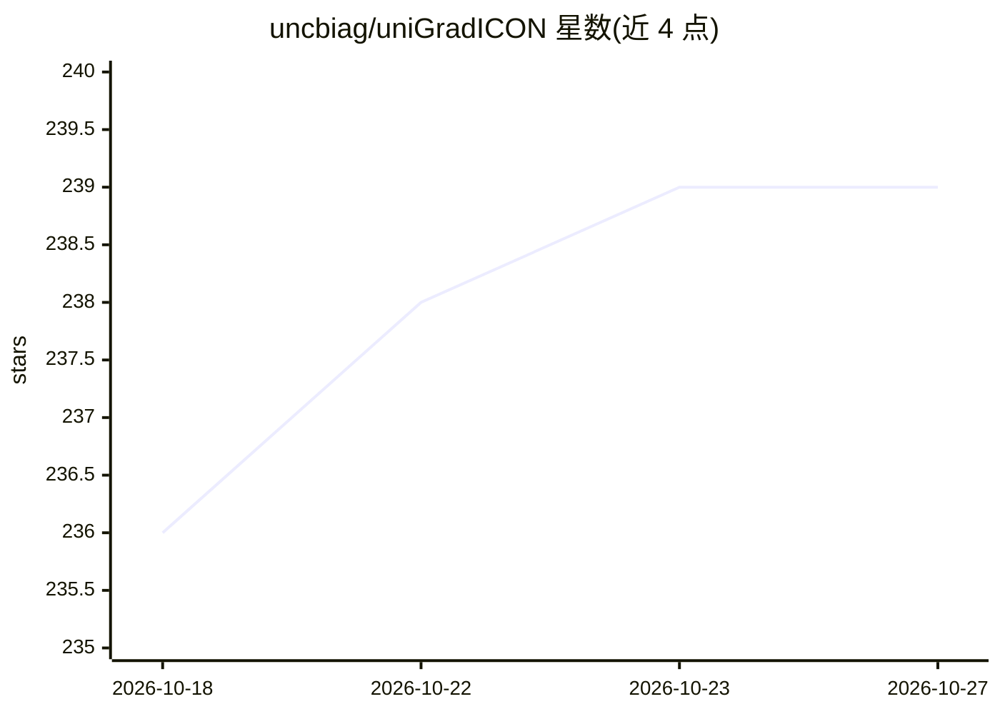

# uncbiag/uniGradICON

⭐ 239 · Python · Apache-2.0 · 推送 2026-10-15 · [GitHub](https://github.com/uncbiag/uniGradICON) · 组织维护

**医学图像配准基础模型：跨数据集预训练，供研究人员使用**

基于 GradICON 在 COPDGene、OAI、HCP、L2R-Abdomen 等多数据集上训练的深度学习医学图像配准模型，支持 MRI/CT/CBCT 多模态，发布 uniGradICON 与多模态 multiGradICON 两个模型。提供 CLI（unigradicon-register/warp/finetune）、Colab notebook 与 3D Slicer 5.7.0 官方扩展三种使用方式，模型权重自动下载；实例优化支持 LNCC/lncc2/MIND SSC 相似度、Dice 损失、强度守恒损失（CT）与掩码输入，并可在自有数据上微调。对应 MICCAI 2024 与 WBIR 2024 论文。

## 筛选速览

| 维度 | 判定 | 备注 |
|---|---|---|
| AI 角色 | `ai-native` | 本体是模型或模型工具 |
| 许可风险 | `permissive` | Apache-2.0 |
| 部署形态 | `library` | 以包/库形式分发 |
| 模型依赖 | — | README 未给出锁定关系 |
| 硬件要求 | — | 无带数字的原话,不猜 |
| 安装摩擦 | `low` | 无编译、无系统依赖或容器化 |
| 成熟度 | — | 结构信号不足 |

## 能力要点

- 跨 4 个训练数据集（肺/膝/脑/腹部，CT 与 MRI）预训练的配准基础模型
- CLI/Colab/3D Slicer 扩展三种推理途径，权重自动下载
- 实例优化支持三种相似度度量、Dice 损失与 CT 强度守恒损失
- 提供在自有数据上微调的 finetune 命令与指南

## 适用场景

- 研究者对脑/肺/膝/腹部 CT-MRI 图像做配准
- 在 3D Slicer 中直接调用预训练配准模型
- 在自有医学影像数据上微调配准模型

## 场景标签

 · 领域:医学图像分析/配准

## 证据(README 行号)

> L12: `uniGradICON` is based on GradICON but trained on several different datasets (see details below).
> L19: **uniGradICON: A Foundation Model for Medical Image Registration**
> L28: The pre-trained uniGradICON and multiGradICON can be used via CLI, colab notebook, and Slicer Extension. The model 

## 星数曲线

2026-10-18 236 → 2026-10-27 239（+3）

---
*卡片 v1 · prompt 1.4 · 生成 2026-10-22 · 置信度 high · 依据 README sha `373414441087` · [字段定义](../../DATASET.md)*
