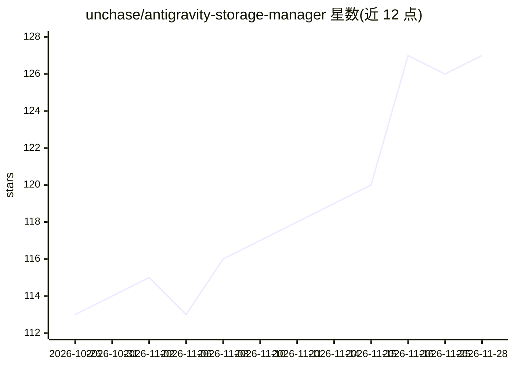

# unchase/antigravity-storage-manager

⭐ 127 · TypeScript · MIT · 推送 2026-11-25 · [GitHub](https://github.com/unchase/antigravity-storage-manager) · 个人维护

**给 Antigravity 用户的 VS Code 配额监控与会话同步扩展**

一个 VS Code 扩展（另发布于 Open VSX），为 Antigravity/Antigravity IDE 用户提供账号与数据管理：状态栏与仪表盘实时跟踪 Gemini、Claude、GPT-OSS 等模型的配额与 Credits，管理多账号配置切换；通过 AES-256-GCM 加密 + Google Drive 在多设备间同步对话数据（.db/.pb），支持本地/网络文件夹存储；附带 Telegram Bot 通知、MCP 服务器连接状态监控、对话导出（ZIP/Markdown）与备份工具，支持 16 种语言界面。

## 筛选速览

| 维度 | 判定 | 备注 |
|---|---|---|
| AI 角色 | `ai-ecosystem` | LLM/agent 周边工具 |
| 许可风险 | `permissive` | MIT |
| 部署形态 | `None` |  |
| 模型依赖 | — | README 未给出锁定关系 |
| 硬件要求 | — | 无带数字的原话,不猜 |
| 安装摩擦 | `low` | 无编译、无系统依赖或容器化 |
| 成熟度 | — | 结构信号不足 |

## 能力要点

- 通过 `agy --hub`/`language_server` 实时监控多模型配额与 Credits
- AES-256-GCM 加密的 Google Drive 会话同步，主密码存于系统钥匙串
- 管理多账号 Profile，合并展示各设备配额用量
- MCP 服务器连接状态监控与 Telegram Bot 远程通知

## 适用场景

- 在 VS Code 里随时查看 Antigravity 各模型剩余配额与重置周期
- 在多台电脑之间加密同步 AI 对话记录
- 为个人与工作账号分别管理配额并快速切换
- 导出/备份对话并在设备间迁移

## 场景标签

 · 领域:开发者工具/AI 账号管理

## 证据(README 行号)

> L5:  Unified AI Gateway with visual dashboard, secure Google Drive sync, Telegram notifications, multi-account profiles,
> L29: - 🚀 **Antigravity Proxy** — Unified AI Gateway with visual dashboard to manage multiple AI providers (Antigravity, 
> L103: - **Antigravity IDE & `agy` Hub / CLI Support**: Automatically discovers local `language_server` / `agy` (`--hub` 

## 星数曲线

2026-10-26 113 → 2026-11-28 127（+14）

---
*卡片 v1 · prompt 1.4 · 生成 2026-11-28 · 置信度 high · 依据 README sha `884a3e4b24aa` · [字段定义](../../DATASET.md)*
