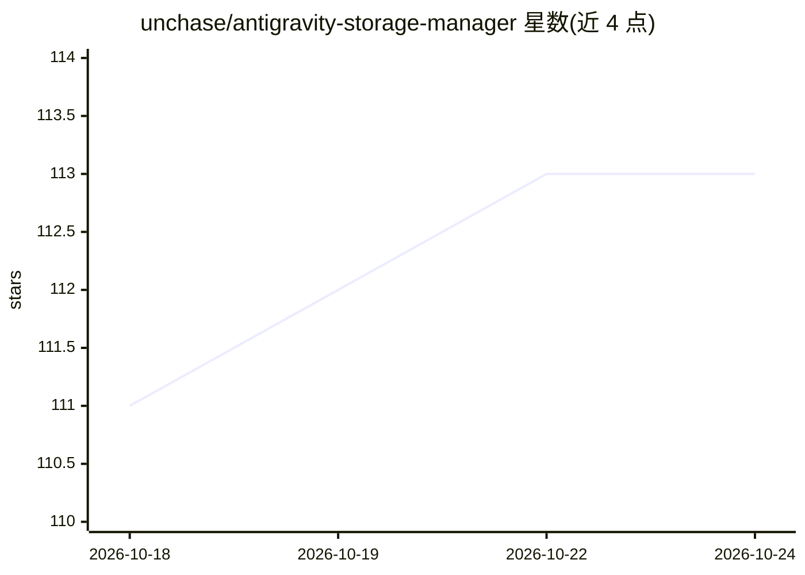

# unchase/antigravity-storage-manager

⭐ 113 · TypeScript · MIT · 推送 2026-09-09 · [GitHub](https://github.com/unchase/antigravity-storage-manager) · 个人维护 · 中文 README

**VS Code 扩展：AI 网关代理、配额监控与对话同步管理**

面向 Antigravity 用户的 VS Code 扩展，核心是本地 Antigravity Proxy：一个 OpenAI 兼容的统一 AI 网关，通过 OAuth 或 API Key 接入 Antigravity、Codex、GitHub Copilot、Claude、Gemini、Z.AI、Vertex、Kiro 等多个提供商，带可视化仪表盘、API Key 管理与企业代理支持。另提供 Google Drive 端到端加密对话同步、Telegram 通知、多账户切换、实时配额监控、MCP 服务器监控与内置 MCP Server，支持对话导出为 Markdown/ZIP 备份。代理二进制可在仪表盘中一键下载安装，默认端点 127.0.0.1:8317/v1。

## 筛选速览

| 维度 | 判定 | 备注 |
|---|---|---|
| AI 角色 | `ai-ecosystem` | LLM/agent 周边工具 |
| 许可风险 | `permissive` | MIT |
| 部署形态 | `None` |  |
| 模型依赖 | locked-api |  |
| 硬件要求 | — | 无带数字的原话,不猜 |
| 安装摩擦 | `low` | 无编译、无系统依赖或容器化 |
| 成熟度 | — | 结构信号不足 |

## 能力要点

- 本地 OpenAI 兼容统一网关，接入 8 个 AI 提供商（OAuth/API Key）
- 端到端加密的 Google Drive 跨设备对话同步
- 实时配额仪表盘与多账户 Profile 切换
- 内置 MCP Server 提供 proxy_status/list_models/chat_completion/get_quota 工具

## 适用场景

- 在 VS Code 内统一管理多个 AI 提供商账号与配额
- 多台机器间安全同步 AI 对话记录
- 让 AI 客户端通过本地代理和 MCP 调用多家模型

## 场景标签

`模型网关` · 领域:Agent 开发

## 证据(README 行号)

> L29: - 🚀 **Antigravity Proxy** — Unified AI Gateway with visual dashboard to manage multiple AI providers (Antigravity, 

## 星数曲线

2026-10-18 111 → 2026-10-24 113（+2）

---
*卡片 v1 · prompt 1.4 · 生成 2026-10-23 · 置信度 high · 依据 README sha `a93e7199956e` · [字段定义](../../DATASET.md)*
