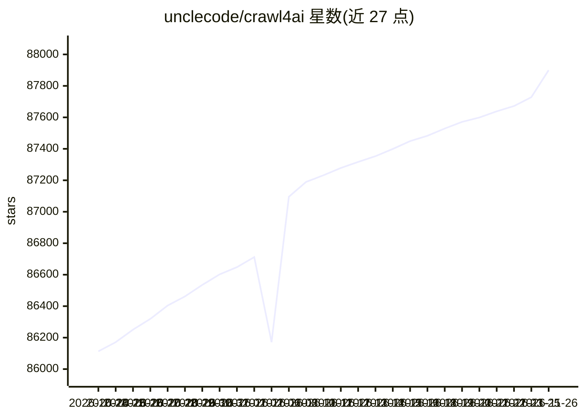

# unclecode/crawl4ai

⭐ 87,900 · Python · Apache-2.0 · 推送 2026-11-23 · [GitHub](https://github.com/unclecode/crawl4ai) · [官网](https://crawl4ai.com/signin/?ref=github-about) · 个人维护

**为 AI agent 提供网页抓取、结构化提取与网络搜索的爬虫库及托管 API**

Apache-2.0 开源爬虫库，同时提供托管云 API：将网页转为适合 LLM 的 Markdown，通过 CSS/XPath 正则或任意 LLM 提取结构化 JSON，并支持深度爬取、会话与代理管理、JavaScript 渲染。可 pip 安装为 Python 库/CLI，或以 Docker 服务自托管（REST API + MCP）。Cloud 版提供搜索、SERP 与免自备 LLM key 的提取，每月 1,000 免费额度。面向为 RAG 与 agent 准备网页数据的开发者。

## 筛选速览

| 维度 | 判定 | 备注 |
|---|---|---|
| AI 角色 | `ai-ecosystem` | LLM/agent 周边工具 |
| 许可风险 | `permissive` | Apache-2.0 |
| 部署形态 | `self-host` | docker 或自建部署 |
| 模型依赖 | — | README 未给出锁定关系 |
| 硬件要求 | — | 无带数字的原话,不猜 |
| 安装摩擦 | `low` | 无编译、无系统依赖或容器化 |
| 成熟度 | — | 结构信号不足 |

## 动量与使用信号

- 维护:`active` — 距上次 push 2.9 天,年发版 15,93 位贡献者
- 涨星:近 1 天 **+65**(自 20261016 起算)
- 安装:pypi 包 `crawl4ai` 月下载 1,275,996
- 平台:— · 协议:MCP / OLLAMA

## 能力要点

- 网页转 LLM 友好的 Markdown，含内容过滤与引用列表
- CSS/XPath/正则免 LLM 提取与 LLM 结构化提取策略
- 自托管 Docker 服务器带 REST API、MCP、监控面板，AMD64/ARM64 镜像
- 异步浏览器池、代理轮换、隐身模式与多引擎（Chromium/Firefox/WebKit）

## 适用场景

- 为 RAG 系统批量抓取网页并生成干净 Markdown 语料
- 从页面中提取结构化 JSON 数据供 agent 使用
- 自托管爬取服务并接入 Claude Code 等 agent 的 MCP
- 对动态渲染、反爬页面执行带代理和会话的深度爬取

## 场景标签

`网页抓取` · 领域:效率与自动化

## 证据(README 行号)

> L9: This repository is home to the Apache-2.0 crawler that powers Crawl4AI Cloud. Run it yourself with Python or Docker.
> L111: - **LLM-ready output**: smart Markdown with headings, tables, code and citation hints
> L132: - 🤖 **LLM extraction**: any LLM provider, open-source or hosted, into a typed JSON schema (`LLMExtractionStrategy`

## 星数曲线

2026-10-24 86,113 → 2026-11-26 87,900（+1,787）

---
*卡片 v1 · prompt 1.4 · 生成 2026-11-24 · 置信度 high · 依据 README sha `693a9eb1fedd` · [字段定义](../../DATASET.md)*
