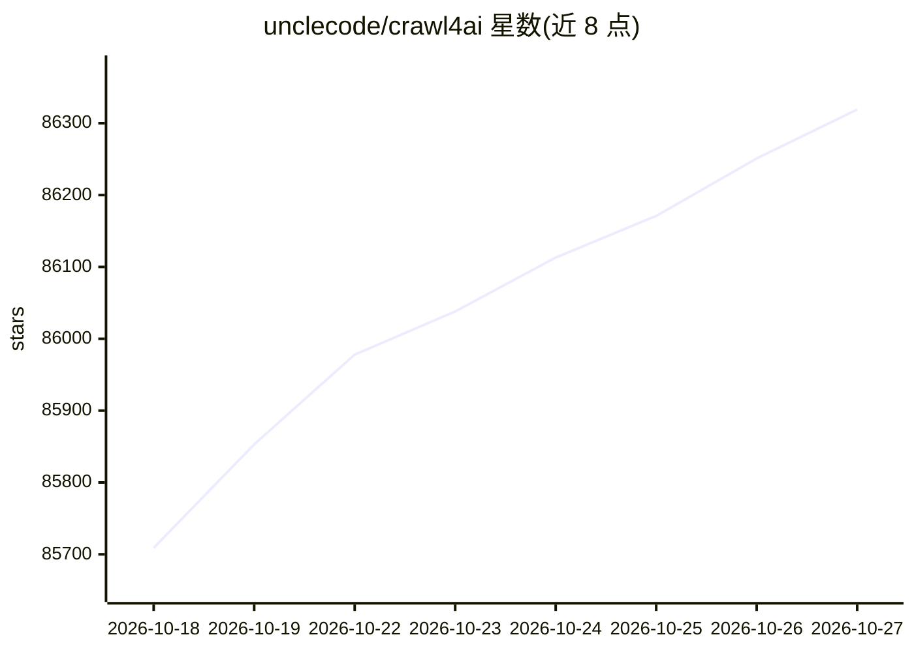

# unclecode/crawl4ai

⭐ 86,319 · Python · Apache-2.0 · 推送 2026-10-26 · [GitHub](https://github.com/unclecode/crawl4ai) · [官网](https://crawl4ai.com) · 个人维护

**为 LLM 与 AI Agent 提供网页抓取，输出干净 Markdown**

开源网页爬取与抓取库，把任意网页转换为面向 LLM 的 Markdown，用于 RAG、AI Agent 与数据管道。提供 Python 库、CLI（crwl）、Docker 自托管服务器与 Crawl4AI Cloud 托管服务四种形态；内置 CSS/XPath/正则等免 LLM 的结构化抽取策略，也支持接入任意 LLM 做 JSON 抽取；通过 Playwright 控制浏览器，支持会话、代理、深爬与自适应爬取。Apache 2.0 协议并要求署名。

## 筛选速览

| 维度 | 判定 | 备注 |
|---|---|---|
| AI 角色 | `ai-native` | 本体是模型或模型工具 |
| 许可风险 | `permissive` | Apache-2.0 |
| 部署形态 | `self-host` | docker 或自建部署 |
| 模型依赖 | — | README 未给出锁定关系 |
| 硬件要求 | — | 无带数字的原话,不猜 |
| 安装摩擦 | `low` | 无编译、无系统依赖或容器化 |
| 成熟度 | — | 结构信号不足 |

## 动量与使用信号

- 维护:`active` — 距上次 push 2.9 天,年发版 15,93 位贡献者
- 涨星:近 1 天 **+65**(自 20261016 起算)
- 安装:pypi 包 `crawl4ai` 月下载 1,275,996
- 平台:— · 协议:MCP / OLLAMA

## 能力要点

- pip 安装后 crawl4ai-setup 一键配置浏览器
- CSS/XPath/正则免 LLM 抽取与 LLM 抽取策略并存
- Docker 自托管 REST API 与 MCP 端点，提供 AMD64/ARM64 镜像
- 云服务提供 /scrape、/extract、/search、/serp、/answer 端点

## 适用场景

- 为 RAG 知识库把网页批量转成 Markdown 语料
- 给 AI Agent 提供 MCP 形式的网页抓取工具
- 用 CSS/XPath 模式从页面抽取结构化 JSON
- 自托管爬取服务器供团队内部调用

## 场景标签

`网页抓取` · 领域:效率与自动化

## 证据(README 行号)

> L19: Crawl4AI turns any website into clean, LLM-ready Markdown for RAG, AI agents and data pipelines. Run the open-sourc
> L100: - 🔎 **CSS and XPath schemas**: fast extraction with no LLM (`JsonCssExtractionStrategy`, `JsonXPathExtractionStrat
> L157: pip install -U crawl4ai

## 星数曲线

2026-10-18 85,709 → 2026-10-27 86,319（+610）

---
*卡片 v1 · prompt 1.4 · 生成 2026-10-18 · 置信度 high · 依据 README sha `285872f1693e` · [字段定义](../../DATASET.md)*
