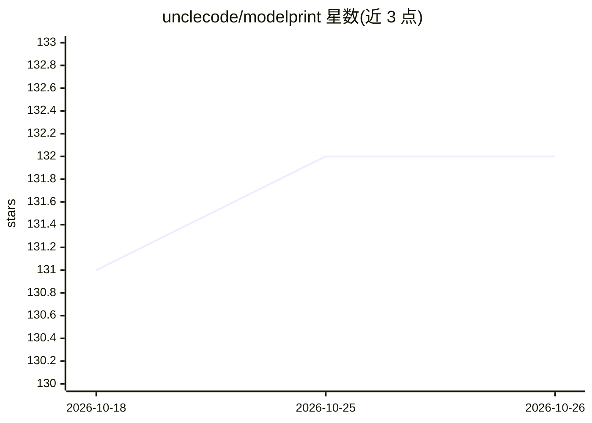

# unclecode/modelprint

⭐ 132 · JavaScript · MIT · 推送 2026-10-25 · [GitHub](https://github.com/unclecode/modelprint) · 个人维护

**在浏览器中对 OpenAI 兼容端点做指纹探测，核验 API 背后模型**

单页 Web 工具：对任意 OpenAI 兼容端点运行基础设施探测（tokenizer 计数、错误码族、响应头、上下文上限、logprob 几何等 15 个已批准探针），并排比较指纹以判断 API 实际服务的模型家族。API key 留在浏览器本地，无需安装或服务器。面向需要核验路由别名或隐蔽模型真实来源的开发者；探针可通过 PR 社区扩展。同栈可服务不同模型，指纹仅证明共享基础设施而非身份。

## 筛选速览

| 维度 | 判定 | 备注 |
|---|---|---|
| AI 角色 | `ai-ecosystem` | LLM/agent 周边工具 |
| 许可风险 | `permissive` | MIT |
| 部署形态 | `None` |  |
| 模型依赖 | — | README 未给出锁定关系 |
| 硬件要求 | — | 无带数字的原话,不猜 |
| 安装摩擦 | `low` | 无编译、无系统依赖或容器化 |
| 成熟度 | — | 结构信号不足 |

## 能力要点

- 15 个已批准探针：tokenizer 计数、错误码族、响应头 DNA、上下文上限、logprob 几何等
- 浏览器内运行，API key 不出本地标签页，无需安装或服务器
- tokenizer 计数按单字符基线归一化，消除隐藏模板影响；探针运行两次并标记 unstable
- 探针按单文件契约编写，经 PR 纳入注册表，社区可扩展

## 适用场景

- 核验路由别名下的 API 是否换成了别的模型
- 比对隐蔽/匿名模型与已知模型家族的基础设施指纹
- 为模型溯源调查自行编写并提交新探针

## 场景标签

 · 领域:LLM 工具/模型溯源

## 证据(README 行号)

> L5: Run infrastructure probes against any OpenAI-compatible endpoint and compare
> L41: The approved registry currently contains 15 probes. These are the probes the

## 星数曲线

2026-10-18 131 → 2026-10-26 132（+1）

---
*卡片 v1 · prompt 1.4 · 生成 2026-10-23 · 置信度 high · 依据 README sha `cc44fcd7e34f` · [字段定义](../../DATASET.md)*
