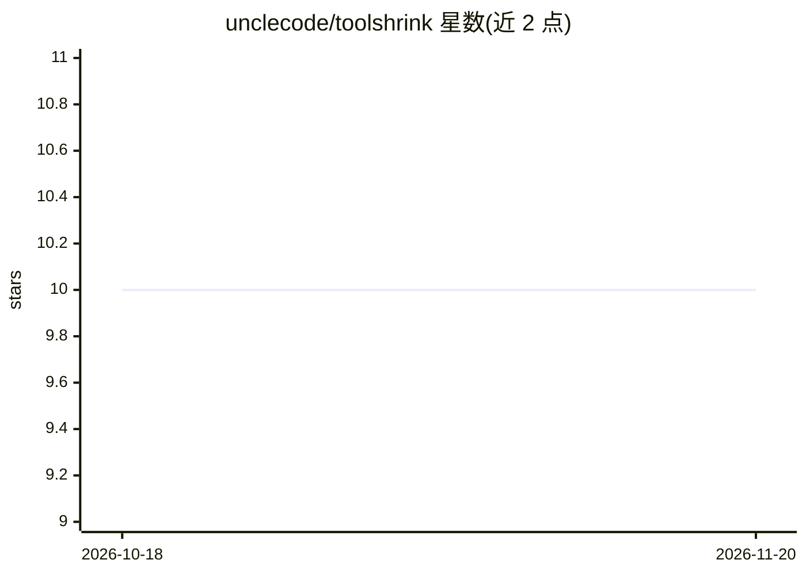

# unclecode/toolshrink

⭐ 10 · TypeScript · MIT · 推送 2026-08-19 · [GitHub](https://github.com/unclecode/toolshrink) · 个人维护

**按内容语义裁剪 agent 工具输出的库：13 种 reducer 加 Harness 插件**

面向 agent 工具输出的内容感知压缩层：先读取输出、识别文本形态（测试、diff、日志、构建、堆栈等），在预算内保留承载信息的部分而非按头尾截断；所有删除以模型可读的省略标记计数，完整原文经 spill store 保存并可按字节还原。提供 DeepSeek Harness 插件一键安装与 JS 库调用两种方式，每个 reducer 是一个共享接口的单文件，支持自定义并可在内置项之前执行。

## 筛选速览

| 维度 | 判定 | 备注 |
|---|---|---|
| AI 角色 | `ai-ecosystem` | LLM/agent 周边工具 |
| 许可风险 | `permissive` | MIT |
| 部署形态 | `library` | 以包/库形式分发 |
| 模型依赖 | locked-api |  |
| 硬件要求 | — | 无带数字的原话,不猜 |
| 安装摩擦 | `low` | 无编译、无系统依赖或容器化 |
| 成熟度 | — | 结构信号不足 |

## 能力要点

- 13 种内容感知 reducer（tests/diff/json/log/stacktrace 等）按文本形态路由
- 删除内容以省略标记计数，完整原文存入 spill store 可还原
- 一行命令作为 DeepSeek Harness 插件安装，默认 50,000 字符预算
- 自定义 cut 为单文件，支持 only/disable 控制内置项

## 适用场景

- 压缩测试运行输出，让 agent 保留失败用例而非通过行
- 控制长日志、git diff、文件列表进入模型上下文的体积
- 为 DeepSeek Harness 等插件化 agent 框架替换默认的按大小截断

## 场景标签

 · 领域:LLM 基础设施/上下文管理

## 证据(README 行号)

> L18: So I built the shrinker I always wished Claude Code had. It reads the output
> L64: ## Use it with DeepSeek Harness

## 星数曲线

2026-10-18 10 → 2026-11-20 10（+0）

---
*卡片 v1 · prompt 1.4 · 生成 2026-11-19 · 置信度 high · 依据 README sha `a4b449a41561` · [字段定义](../../DATASET.md)*
