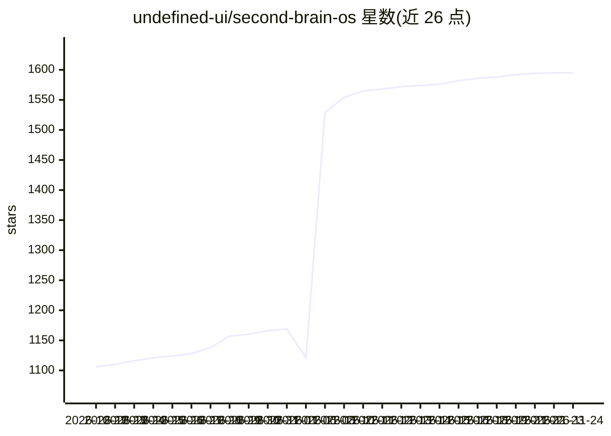

# undefined-ui/second-brain-os

⭐ 1,598 · HTML · MIT · 推送 2026-11-03 · [GitHub](https://github.com/undefined-ui/second-brain-os) · [官网](https://secondbrainos.dev) · 个人维护

**面向 AI 工程师的 agent 课程、手册与知识库实践教程集**

为 AI 工程师整理的指南与资源仓库：一门七模块的 agent 构建课程、五份分层手册（知识图谱/门控/harness/循环/评测）、一个由 agent 构建和维护的 markdown 个人知识库（second brain）实操项目，以及 114 条逐条核验过来源的阅读清单。附带一个 Claude Code 插件、18 个 skills、72 个 slash 命令和 6 个 subagents。全部为纯 markdown，MIT 许可，网站版提供交互地图，无需注册即可阅读。

## 筛选速览

| 维度 | 判定 | 备注 |
|---|---|---|
| AI 角色 | `ai-knowledge` | 知识聚合/清单类 |
| 许可风险 | `permissive` | MIT |
| 部署形态 | `library` | 以包/库形式分发 |
| 模型依赖 | — | README 未给出锁定关系 |
| 硬件要求 | — | 无带数字的原话,不猜 |
| 安装摩擦 | `low` | 无编译、无系统依赖或容器化 |
| 成熟度 | — | 结构信号不足 |

## 能力要点

- 七模块 agent 课程：从单个 prompt 到生产级 agent
- 五份分层手册，每份深入一层，每份以实操构建收尾
- second brain 实操项目：agent 用纯 markdown 构建维护知识库
- 114 条经核验的资源清单，每月更新

## 适用场景

- 系统学习从零到生产构建 agent
- 针对 agent 某一层（上下文/循环/门控/评测）深入查阅
- 用 Claude Code 搭建 agent 维护的个人知识库

## 场景标签

`教程课程` `精选清单` `知识库管理` · 领域:知识与检索

## 证据(README 行号)

> L3: Guides and resources for AI engineers: a course on building agents, five
> L17: - **The agents course:** seven modules from a single prompt to a production agent, covering context, loops, gates, 
> L22: - **Plain markdown, MIT licensed.** No signup, nothing to install to read it

## 星数曲线

2026-10-22 1,106 → 2026-11-24 1,595（+489）

---
*卡片 v1 · prompt 1.4 · 生成 2026-11-23 · 置信度 mid · 依据 README sha `89e8e8c61796` · [字段定义](../../DATASET.md)*
