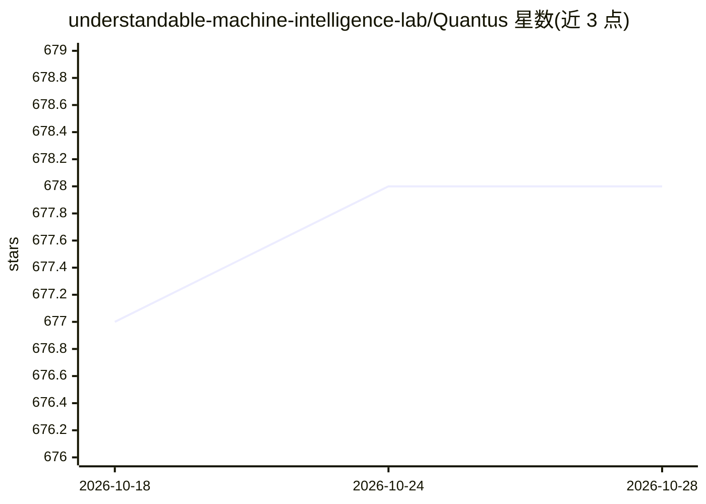

# understandable-machine-intelligence-lab/Quantus

⭐ 678 · Jupyter Notebook · NOASSERTION · 推送 2026-10-26 · [GitHub](https://github.com/understandable-machine-intelligence-lab/Quantus) · [官网](https://quantus.readthedocs.io/) · 组织维护

**XAI 评测工具包：量化评估神经网络解释方法的质量**

面向可解释 AI（XAI）研究的 Python 工具包，对神经网络解释（归因）方法做定量评估：提供 35+ 个指标，分为忠实性、鲁棒性、定位、复杂度、随机化敏感性与公理化六类。支持 PyTorch 与 TensorFlow 模型，覆盖图像、时间序列、表格等数据类型，并内置对 captum、tf-explain、zennit 等解释方法库的支持。以 pip 包形式发布，论文发表于 JMLR (MLOSS)。README 声明仍处积极开发期，指标实现未经原作者验证，需注意版本以保证可复现性。

## 筛选速览

| 维度 | 判定 | 备注 |
|---|---|---|
| AI 角色 | `ai-ecosystem` | LLM/agent 周边工具 |
| 许可风险 | `none` | NOASSERTION |
| 部署形态 | `library` | 以包/库形式分发 |
| 模型依赖 | — | README 未给出锁定关系 |
| 硬件要求 | — | 无带数字的原话,不猜 |
| 安装摩擦 | `low` | 无编译、无系统依赖或容器化 |
| 成熟度 | `idea` | |

## 能力要点

- 35+ 个 XAI 评测指标，分 6 大类别
- 支持 PyTorch 与 TensorFlow 模型及多种数据类型
- 内置 captum / tf-explain / zennit 解释方法支持
- 发表于 JMLR (MLOSS) 的同行评审论文

## 适用场景

- 对比多个归因方法在忠实性、鲁棒性等维度上的表现
- 为自研解释方法做标准化定量评测
- 分析评测参数（如扰动策略）对方法排名的敏感性

## 场景标签

`模型评测` · 领域:评测与运维

## 证据(README 行号)

> L26: - Offers more than **35+ metrics in 6 categories** for XAI evaluation
> L55: This project started with the goal of collecting existing evaluation metrics that have been introduced in the conte

## 星数曲线

2026-10-18 677 → 2026-10-28 678（+1）

---
*卡片 v1 · prompt 1.4 · 生成 2026-10-21 · 置信度 high · 依据 README sha `69d0b53216fe` · [字段定义](../../DATASET.md)*
