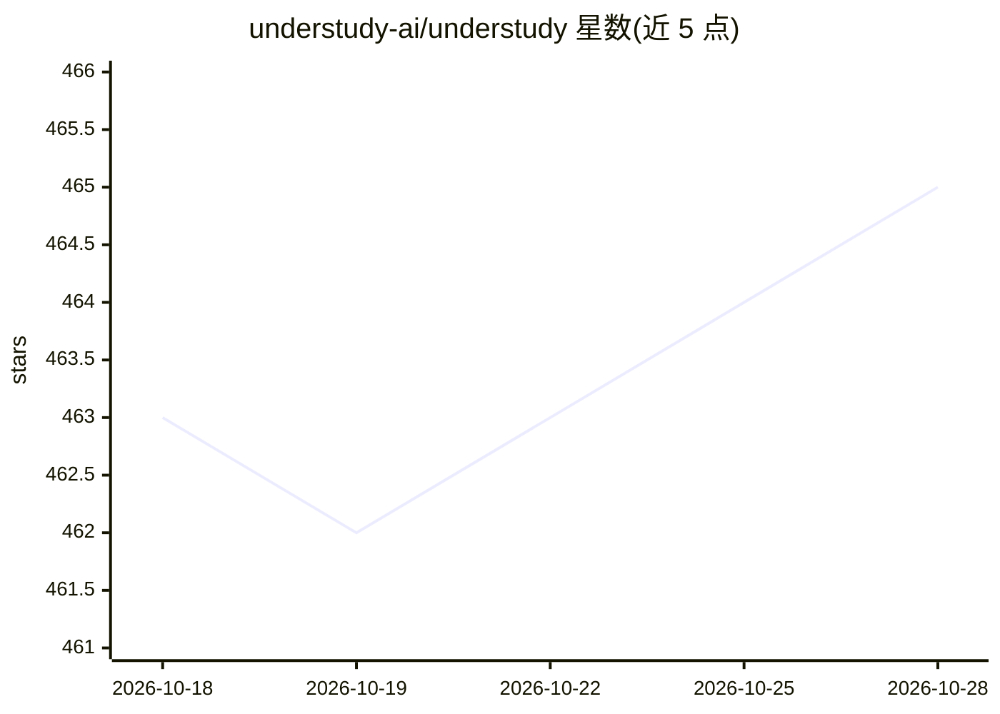

# understudy-ai/understudy

⭐ 465 · TypeScript · MIT · 推送 2026-06-19 · [GitHub](https://github.com/understudy-ai/understudy) · [官网](https://understudy-ai.github.io/understudy/) · 组织维护 · 中文 README

**开源本地 AI agent：一条指令操控整台电脑，可教学复用**

面向个人用户的本地 AI agent，运行时以 macOS 为已实现平台，在单一会话中混合 GUI 操作（截图定位+原生输入）、Playwright 浏览器、Shell、网络检索、跨会话语义记忆、8 个消息渠道（Telegram/Discord/Slack 等）与定时任务，自带模型接入。特色是示范教学：演示一次任务后提取意图生成可复用的 SKILL.md，技能经受 UI 改版仍可复用。产物体系分为 skill/worker/playbook 三类，可编排多阶段流水线。Layer 1-2 已实现，Layer 3-4 部分实现，Layer 5 为长期方向。教学分析与 GUI 定位可能向配置的模型提供方发送截图等图像证据。

## 筛选速览

| 维度 | 判定 | 备注 |
|---|---|---|
| AI 角色 | `ai-native` | 本体是模型或模型工具 |
| 许可风险 | `permissive` | MIT |
| 部署形态 | `desktop` | 安装包/桌面程序 |
| 模型依赖 | — | README 未给出锁定关系 |
| 硬件要求 | — | 无带数字的原话,不猜 |
| 安装摩擦 | `medium` | 含编译或系统依赖之一 |
| 成熟度 | `idea` | |

## 能力要点

- 单一 agent 循环内混合 GUI/浏览器/Shell/检索/记忆/消息等 8 种执行路由
- 示范教学提取意图而非坐标，生成可复用、可跨 UI 改版的技能
- skill/worker/playbook 三类工作区产物，可编排多子代理流水线
- 支持 8 个内置消息渠道与远程派发（手机发指令，桌面执行）

## 适用场景

- 一条指令完成网页调研、文件处理并发送到消息应用的全流程
- 把日常重复操作教给 agent，之后用自然语言调用复用
- 离开电脑时通过 Telegram 等远程派发桌面任务

## 场景标签

`AI 助手` `GUI 自动化` `浏览器自动化` · 领域:效率与自动化

## 证据(README 行号)

> L13: Open-source local AI agent that operates your entire computer — GUI, browser, shell, messaging — from a single inst
> L134: **Status:** implemented today on macOS.

## 星数曲线

2026-10-18 463 → 2026-10-28 465（+2）

---
*卡片 v1 · prompt 1.4 · 生成 2026-10-21 · 置信度 high · 依据 README sha `ad64a6f3f3e8` · [字段定义](../../DATASET.md)*
