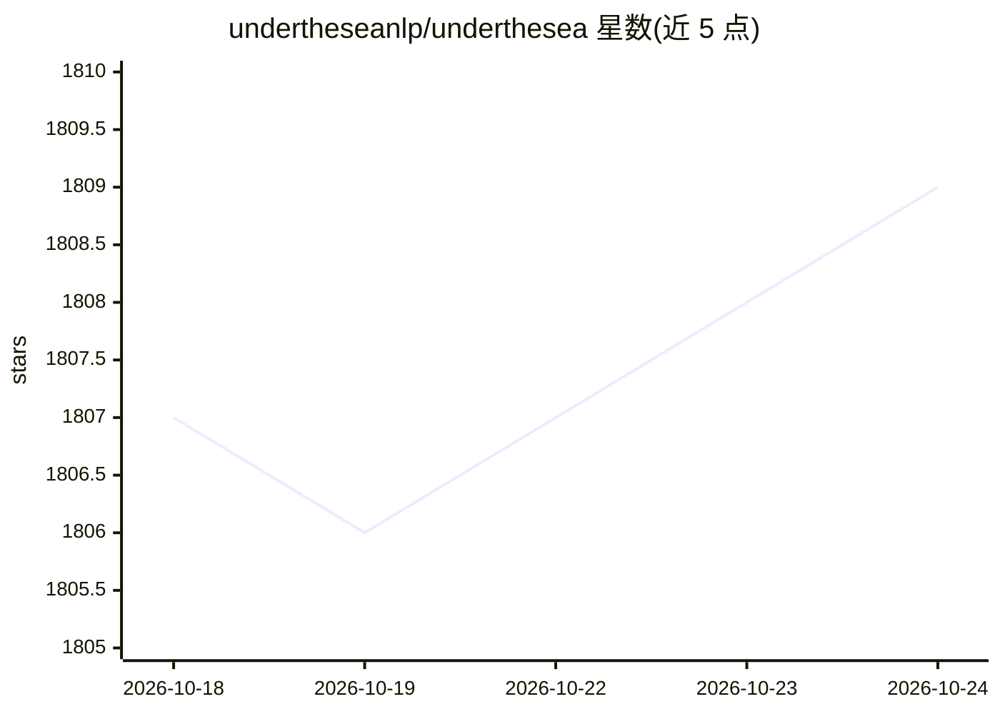

# undertheseanlp/underthesea

⭐ 1,809 · Python · Apache-2.0 · 推送 2026-10-20 · [GitHub](https://github.com/undertheseanlp/underthesea) · [官网](http://undertheseanlp.com) · 组织维护

**越南语 NLP 工具集 + 多供应商 AI Agent 工具包（Python 库）**

自 v9.3.0 起定位为开源 Agentic AI 工具包：提供基于 Python stdlib（urllib+json）实现的多供应商 AI Agent 模块，支持 OpenAI、Azure OpenAI、Anthropic Claude、Google Gemini 四个 LLM API，零外部依赖，含流式输出、工具调用（12 个内置工具）、多会话、本地自动 trace、A2A 协议 serving。同时保留越南语 NLP 模块套件：分词、词性标注、命名实体识别、情感分析、依存句法、翻译、TTS 等 13 类 pipeline。以 pip 包分发。

## 筛选速览

| 维度 | 判定 | 备注 |
|---|---|---|
| AI 角色 | `ai-ecosystem` | LLM/agent 周边工具 |
| 许可风险 | `permissive` | Apache-2.0 |
| 部署形态 | `library` | 以包/库形式分发 |
| 模型依赖 | locked-api |  |
| 硬件要求 | — | 无带数字的原话,不猜 |
| 安装摩擦 | `low` | 无编译、无系统依赖或容器化 |
| 成熟度 | — | 结构信号不足 |

## 能力要点

- 多供应商 Agent 仅用 Python stdlib 调用 LLM API，无需 openai/anthropic SDK
- 12 个内置工具（计算器、web 搜索、shell、python exec 等）与工具调用
- A2A 协议 serving：JSON-RPC over HTTP+SSE，AgentCard 发现，原生 ASGI 无框架依赖
- 越南语 NLP 13 类 pipeline（分词/NER/情感/依存句法/翻译/TTS 等）

## 适用场景

- 构建接入 OpenAI/Claude/Gemini 的 Python AI Agent
- 处理越南语文本：分词、命名实体识别、情感分析
- 通过 A2A 协议把 Agent 作为服务对外暴露

## 场景标签

 · 领域:NLP/Agent 工具包

## 证据(README 行号)

> L27: Open-source Agentic AI Toolkit
> L31: 🌊 **An Agentic AI Toolkit.** Since v9.3.0, Underthesea is an open-source Agentic AI Toolkit with built-in Vietnames
> L161: ## Vietnamese NLP

## 星数曲线

2026-10-18 1,807 → 2026-10-24 1,809（+2）

---
*卡片 v1 · prompt 1.4 · 生成 2026-10-21 · 置信度 high · 依据 README sha `f740ab55466f` · [字段定义](../../DATASET.md)*
