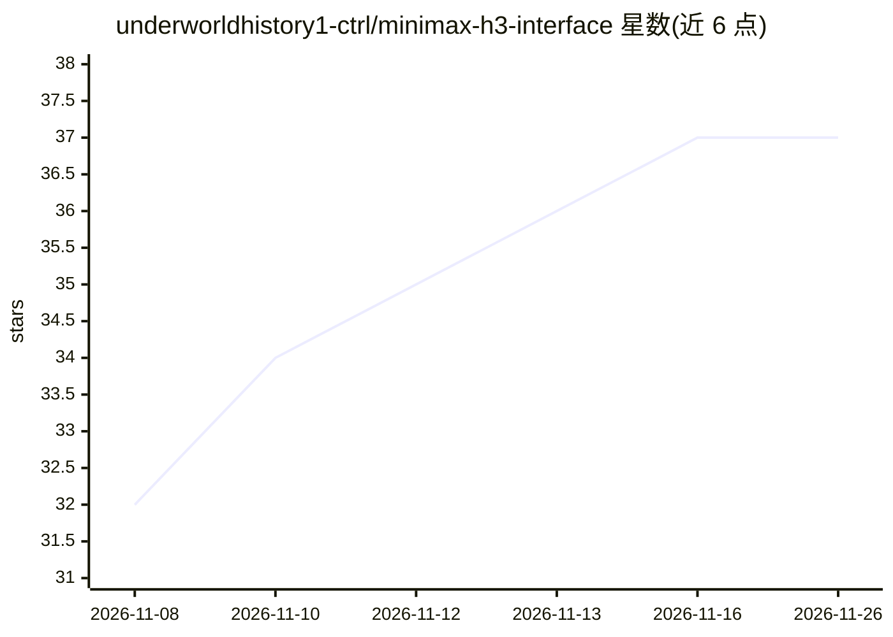

# underworldhistory1-ctrl/minimax-h3-interface

⭐ 37 · Python · MIT · 推送 2026-11-25 · [GitHub](https://github.com/underworldhistory1-ctrl/minimax-h3-interface) · [官网](https://underworldhistory1-ctrl.github.io/minimax-h3-interface/) · 组织维护

**自托管 MiniMax H3 视频生成与 Qwen 图像创作的浏览器工作台**

基于 ComfyUI 构建的本地创作界面：在自有 NVIDIA 机器或 GPU 服务器上运行，提供 MiniMax H3 文生视频（含原生音频）、图像动画化、参考图/视频/音频引导生成、分镜引导，以及 Qwen Image 2.1 的图像创建与编辑（最多十个参考图、LoRA）。用户在 Studio 中做选择，系统编译为连接的 ComfyUI 图，含能力检查与冲突拒绝；支持项目/场景/复用管理、布局自定义与更新校验。权重不随附，需自行下载；模型需要较大磁盘、内存与 VRAM。

## 筛选速览

| 维度 | 判定 | 备注 |
|---|---|---|
| AI 角色 | `ai-native` | 本体是模型或模型工具 |
| 许可风险 | `permissive` | MIT |
| 部署形态 | `None` |  |
| 模型依赖 | — | README 未给出锁定关系 |
| 硬件要求 | — | 无带数字的原话,不猜 |
| 安装摩擦 | `low` | 无编译、无系统依赖或容器化 |
| 成熟度 | — | 结构信号不足 |

## 能力要点

- FL2VA/Ref2VA 视频生成，原生音频输出
- 参考限制：12 文件、9 图、3 视频 15 秒、3 音频 15 秒
- 选择项自动编译为 ComfyUI 图，含能力检查与不兼容阻断
- Qwen Image 2.1 图像创建/编辑，支持角色、任务工作流与图像 LoRA

## 适用场景

- 在本机 GPU 上生成带原生音频的视频
- 用分镜与角色参考控制镜头产出
- 在同一工作台内制作配套图像并作为参考复用

## 场景标签

`视频生成` `图像生成` · 领域:内容生成

## 证据(README 行号)

> L3: **MiniMax H3 video with native audio. Qwen Image 2.1 creation and editing. One browser workspace on your own NVIDIA 
> L27: Start directly in Production, write a prompt, attach inputs and generate. **Save scene** or **Generate** creates a 
> L33: |Text to video|Original FL2VA generation with native audio|

## 星数曲线

2026-11-08 32 → 2026-11-26 37（+5）

---
*卡片 v1 · prompt 1.4 · 生成 2026-11-18 · 置信度 high · 依据 README sha `2eba5e698aa3` · [字段定义](../../DATASET.md)*
