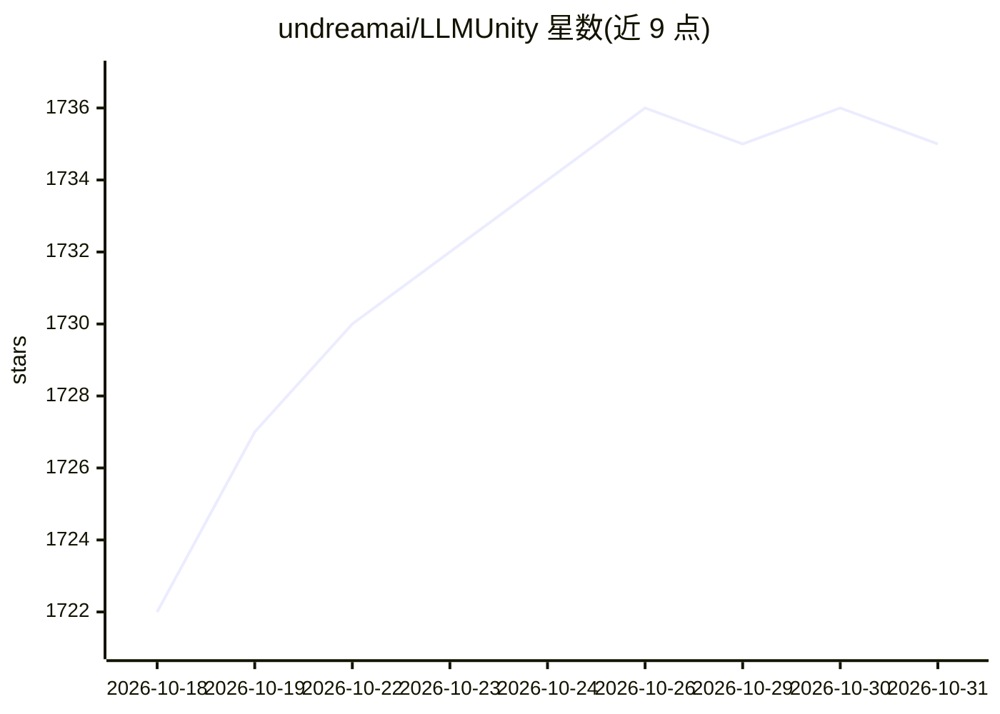

# undreamai/LLMUnity

⭐ 1,735 · C# · Apache-2.0 · 推送 2026-04-29 · [GitHub](https://github.com/undreamai/LLMUnity) · [官网](https://undream.ai) · 组织维护

**在 Unity 游戏中本地运行 LLM 驱动可对话 AI 角色的库**

面向 Unity 游戏开发者的 LLM 集成包：后端 LlamaLib 基于 llama.cpp 构建为独立 C++/C# 库，支持在 PC、移动与 VR 上本地或经远程服务器运行推理，玩家可与 AI 角色对话。提供 LLM/LLMAgent 组件、语法限制与 function calling、聊天历史保存加载、基于 usearch ANN 的 RAG 语义检索。兼容 .gguf 模型，移动端建议 1-2B 参数模型，在 Unity 2021 LTS 至 Unity 6 测试。

## 筛选速览

| 维度 | 判定 | 备注 |
|---|---|---|
| AI 角色 | `ai-ecosystem` | LLM/agent 周边工具 |
| 许可风险 | `permissive` | Apache-2.0 |
| 部署形态 | `None` |  |
| 模型依赖 | local-ok | 支持本地模型 |
| 硬件要求 | — | 无带数字的原话,不猜 |
| 安装摩擦 | `low` | 无编译、无系统依赖或容器化 |
| 成熟度 | — | 结构信号不足 |

## 能力要点

- 基于 llama.cpp 的 LlamaLib 后端，支持 CPU/GPU（Nvidia、AMD、Apple Metal）本地推理
- LlmAgent 组件 + 单行代码调用实现游戏内 AI 角色对话
- RAG 系统：LLM 嵌入 + usearch ANN 语义检索，支持分块与数据分组
- 支持语法/gbnf 约束输出、function calling 与远程服务器部署

## 适用场景

- 为游戏角色添加本地运行的 LLM 对话能力
- 用 RAG 让角色基于自定义文本数据回答
- 把推理放到远程服务器，游戏客户端连接使用

## 场景标签

`聊天机器人` `RAG` · 领域:对话与助手

## 证据(README 行号)

> L11: LLM for Unity enables seamless integration of Large Language Models (LLMs) within the Unity engine.
> L15: The LLM backend, LlamaLib, is built on top of the awesome llama.cpp library and provided as a standalone C++/C# lib
> L35: - 🔧 Easy to setup, call with a single line of code

## 星数曲线

2026-10-18 1,722 → 2026-10-31 1,735（+13）

---
*卡片 v1 · prompt 1.4 · 生成 2026-10-21 · 置信度 high · 依据 README sha `3fa8c5f5b6b5` · [字段定义](../../DATASET.md)*
