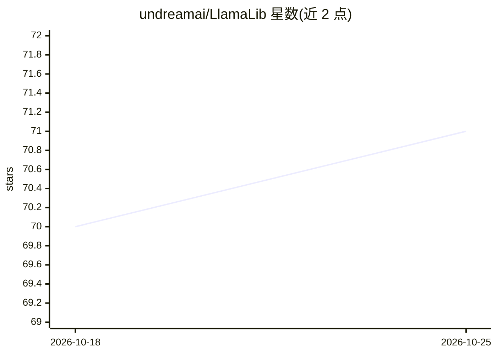

# undreamai/LlamaLib

⭐ 71 · C++ · Apache-2.0 · 推送 2026-03-08 · [GitHub](https://github.com/undreamai/LlamaLib) · [官网](https://undream.ai) · 组织维护

**跨平台高级 C++/C# LLM 运行库：PC、移动与 VR 头显上本地运行大模型**

基于 llama.cpp 构建的 C++ 与 C# 高层库，将 LLM 运行能力嵌入应用程序内，无需独立服务器、开放端口或外部进程，零外部依赖。支持 Windows/macOS/Linux、Android/iOS 及 Meta Quest、Apple Vision、Magic Leap 等 VR/AR 设备，运行时自动检测硬件架构并选择 NVIDIA/AMD/Metal GPU 或 CPU 后端。提供 LLMService/LLMClient/LLMAgent 三个核心类，覆盖补全、分词、嵌入、服务端-客户端（含 SSL 与认证）等场景，集成体积 CPU 约 100 MB。据称支撑 LLM for Unity 游戏集成方案。

## 筛选速览

| 维度 | 判定 | 备注 |
|---|---|---|
| AI 角色 | `ai-ecosystem` | LLM/agent 周边工具 |
| 许可风险 | `permissive` | Apache-2.0 |
| 部署形态 | `None` |  |
| 模型依赖 | — | README 未给出锁定关系 |
| 硬件要求 | — | 无带数字的原话,不猜 |
| 安装摩擦 | `low` | 无编译、无系统依赖或容器化 |
| 成熟度 | — | 结构信号不足 |

## 能力要点

- C++/C# 面向对象高层 API，嵌入应用内运行，无需外部进程
- 跨平台跨设备：桌面、移动端与 Meta Quest/Apple Vision/Magic Leap
- 运行时自动检测硬件并选择 GPU/CPU 后端
- LLMService/LLMClient/LLMAgent 三类核心抽象，支持本地与客户端-服务器部署（含 SSL 与认证）

## 适用场景

- 在 C++ 或 C# 应用中嵌入本地 LLM 推理能力
- 为移动端或 VR/AR 头显应用接入大模型
- 构建带记忆的聊天机器人或交互式 AI agent

## 场景标签

`推理引擎` `聊天机器人` · 领域:对话与助手

## 证据(README 行号)

> L11: LlamaLib is a **high-level C++ and C#** library for running Large Language Models (LLMs) **anywhere** - from PCs to
> L85: |**LLMService**|LLM backend engine|Building standalone apps or servers|

## 星数曲线

2026-10-18 70 → 2026-10-25 71（+1）

---
*卡片 v1 · prompt 1.4 · 生成 2026-10-24 · 置信度 high · 依据 README sha `43860234a069` · [字段定义](../../DATASET.md)*
