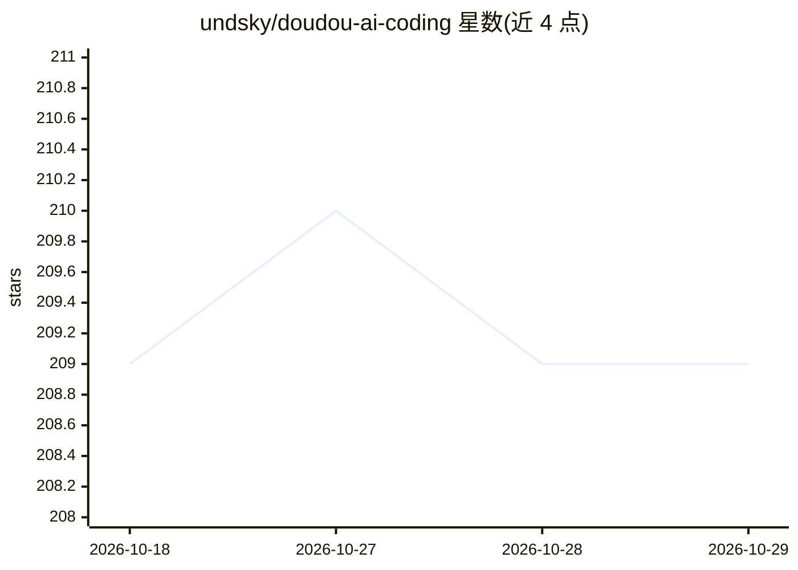

# undsky/doudou-ai-coding

⭐ 209 · Vue · NOASSERTION · 推送 2026-09-17 · [GitHub](https://github.com/undsky/doudou-ai-coding) · [官网](https://www.undsky.com) · 个人维护 · 中文 README

**面向编程小白与中小企业的 AI 全流程开发平台**

豆豆（DouDou）AI 全流程开发平台，面向个人（编程小白）与小中型企业，覆盖后端服务、Web 前端和移动端 h5、APP、小程序开发。通过在 AI 对话框输入指令完成五步流程：初始化知识库并导入资料、启动开发环境、生成产品需求文档与数据库表结构、自动生成代码（EggJS/Vue3/UniApp 三套目录）与自动测试。要求任意支持 AI 终端或 IDE，移动开发需安装 HBuilderX，另需 nodejs 与 python。配套技能包括 doudou-llm-wiki-skill、doudou-ai-coding-skills、ui-ux-pro-max。采用 CC BY-NC 4.0 许可证。

## 筛选速览

| 维度 | 判定 | 备注 |
|---|---|---|
| AI 角色 | `ai-native` | 本体是模型或模型工具 |
| 许可风险 | `none` | NOASSERTION |
| 部署形态 | `None` |  |
| 模型依赖 | — | README 未给出锁定关系 |
| 硬件要求 | — | 无带数字的原话,不猜 |
| 安装摩擦 | `low` | 无编译、无系统依赖或容器化 |
| 成熟度 | — | 结构信号不足 |

## 能力要点

- 五步对话式流程：知识库→环境→产品设计→开发→测试
- 代码自动生成到 doudou-eggjs、doudou-vue3、doudou-uniapp 目录
- 产品设计阶段产出需求文档、数据库表结构、测试用例等文档

## 适用场景

- 不会编程的用户通过对话把点子做成可运行的软件
- 小中型企业快速搭建后端、Web 与移动端应用
- 基于自有资料建立知识库辅助 AI 开发

## 场景标签

`编码 Agent` `代码生成` · 领域:编码与开发

## 证据(README 行号)

> L7:  豆豆（DouDou）AI 全流程开发平台，面向个人（编程小白）、小中型企业，覆盖后端服务、Web 前端和移动端h5、APP、小程序开发。
> L28: 即使你**完全不会编程、一行代码都没写过**，也只要按照下面的 5 个步骤，在 AI 对话框里输入简单的一句话，就能把脑海里的一个点子，变成真正能点击、能使用的精美软件！

## 星数曲线

2026-10-18 209 → 2026-10-29 209（+0）

---
*卡片 v1 · prompt 1.4 · 生成 2026-10-22 · 置信度 mid · 依据 README sha `664d11cd5c7d` · [字段定义](../../DATASET.md)*
