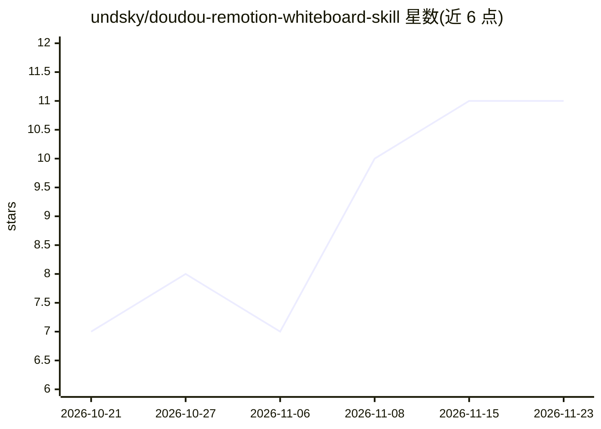

# undsky/doudou-remotion-whiteboard-skill

⭐ 11 · TypeScript · NOASSERTION · 推送 2026-09-26 · [GitHub](https://github.com/undsky/doudou-remotion-whiteboard-skill) · [官网](https://www.undsky.com) · 个人维护 · 中文 README

**供 AI Agent 调用的 Remotion 手绘白板动画技能库**

以 skill 形式发布的 Remotion 动效引擎，供 AI Agent 在视频工程中生成手绘白板风格内容；通过 npx skills 命令安装到目标工程根目录，用户以自然语言提示词驱动 Agent 产出。核心模块包括物理笔刷与人手跟随、手绘几何与箭头连接、素描排线阴影填充、逐字显现的手写文本，以及素描纸/蓝图/黑板/牛皮纸/白板五种底纸材质。采用 CC BY-NC 4.0 许可，商业用途需联系作者单独授权。

## 筛选速览

| 维度 | 判定 | 备注 |
|---|---|---|
| AI 角色 | `ai-knowledge` | 知识聚合/清单类 |
| 许可风险 | `none` | NOASSERTION |
| 部署形态 | `library` | 以包/库形式分发 |
| 模型依赖 | — | README 未给出锁定关系 |
| 硬件要求 | — | 无带数字的原话,不猜 |
| 安装摩擦 | `low` | 无编译、无系统依赖或容器化 |
| 成熟度 | — | 结构信号不足 |

## 能力要点

- 物理笔刷模块：笔尖锚点对齐、切线平滑转向、抬笔/落笔高度动力学
- 素描排线：单向斜排线与双向十字交叉排线的扫描线算法填充
- 五种内置底纸材质（素描纸/蓝图网格/黑板/牛皮纸/白板）
- 手写文本逐字切片显现并回传字流末端坐标

## 适用场景

- 让 AI Agent 用手绘白板风格制作微服务架构演进解说视频
- 制作黑板粉笔风格的学术讲座公式推演视频
- 用素描纸底图制作商业模式演进的商业解说长卷

## 场景标签

`视频生成` · 领域:内容生成

## 证据(README 行号)

> L15: 本技能库作为 **AI Agent 与 Remotion 视频工程的手绘白板动效引擎**（原生支持 Antigravity、Claude Code、OpenCode 等平台）。
> L22: npx skills add undsky/doudou-remotion-whiteboard-skill --yes

## 星数曲线

2026-10-21 7 → 2026-11-23 11（+4）

---
*卡片 v1 · prompt 1.4 · 生成 2026-11-18 · 置信度 high · 依据 README sha `27733526e2a4` · [字段定义](../../DATASET.md)*
