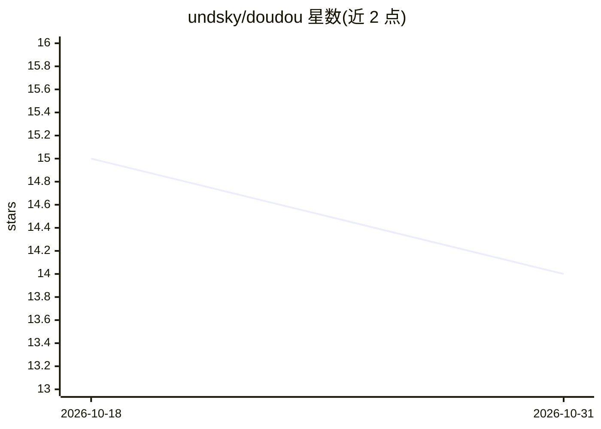

# undsky/doudou

⭐ 14 · JavaScript · 推送 2026-09-28 · [GitHub](https://github.com/undsky/doudou) · [官网](https://www.undsky.com) · 个人维护 · 中文 README

**集成 AI 智能体与画布等功能的 Chrome 日常工具箱扩展**

一款 Chrome 扩展形式的日常工具箱，功能包含 AI 智能体平台（智能体管理与应用）、AI 画布自由创作，以及多项开发辅助工具：API 接口请求与响应调试、整页或区域截图、CORS 跨域解除、生成当前页二维码、导出 Cookies、选取页面元素下载为 Markdown。安装方式为下载或克隆仓库后在 Chrome 扩展程序页开启开发者模式、加载已解压的扩展程序，面向普通用户与开发者日常使用。

## 筛选速览

| 维度 | 判定 | 备注 |
|---|---|---|
| AI 角色 | `ai-enhanced` | 去掉 AI 部分产品仍成立 |
| 许可风险 | `none` | — |
| 部署形态 | `None` |  |
| 模型依赖 | — | README 未给出锁定关系 |
| 硬件要求 | — | 无带数字的原话,不猜 |
| 安装摩擦 | `low` | 无编译、无系统依赖或容器化 |
| 成熟度 | — | 结构信号不足 |

## 能力要点

- AI 智能体平台：智能体管理与应用
- AI 画布自由创作
- API 调试、页面截图、CORS Unblock、二维码生成、Cookies 导出、页面转 Markdown 等工具

## 适用场景

- 在浏览器内调试 API 接口请求与响应
- 对网页整页或选区截图并导出 Markdown
- 解除跨域限制、生成二维码、导出 Cookies 等日常提效操作

## 场景标签

`AI 助手` `网页抓取` · 领域:效率与自动化

## 证据(README 行号)

> L3: 一款集日常提效与开发辅助于一体的 Chrome 扩展工具箱。
> L5: - 🤖 **AI 智能体平台**：智能体管理与应用
> L6: - ♾️ **AI 画布**：自由创作，无限可能

## 星数曲线

2026-10-18 15 → 2026-10-31 14（-1）

---
*卡片 v1 · prompt 1.4 · 生成 2026-10-30 · 置信度 high · 依据 README sha `439a074619a5` · [字段定义](../../DATASET.md)*
