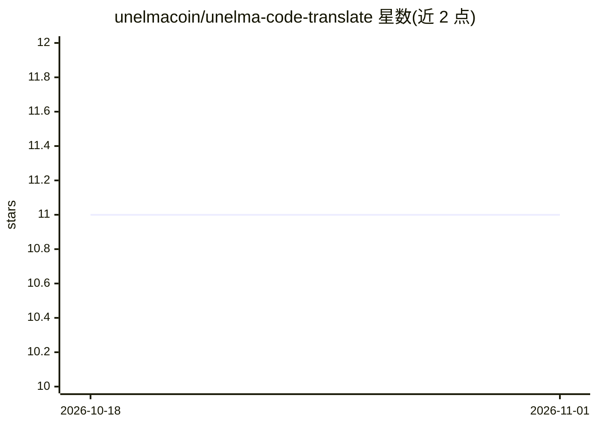

# unelmacoin/unelma-code-translate

⭐ 11 · TypeScript · MIT · 推送 2026-04-02 · [GitHub](https://github.com/unelmacoin/unelma-code-translate) · [官网](https://translate.u16p.com) · 组织维护

**给开发者的 AI 编程语言代码翻译工具（网页+REST API）**

由 Unelma Platforms 开发的开源代码翻译工具：用户提交源代码并指定源/目标语言，由 AI 生成翻译结果，支持 Python、Java、C++、JS、COBOL 等语言。提供在线服务（translate.u16p.com）与本地部署两种方式；本地运行需 Node.js v16+ 与 Python 3.8+，并配置 OpenAI API key。内置 REST API（Bearer 认证、限流、Swagger 文档），保留旧版端点用于向后兼容。MIT 许可。

## 筛选速览

| 维度 | 判定 | 备注 |
|---|---|---|
| AI 角色 | `ai-native` | 本体是模型或模型工具 |
| 许可风险 | `permissive` | MIT |
| 部署形态 | `library` | 以包/库形式分发 |
| 模型依赖 | — | README 未给出锁定关系 |
| 硬件要求 | — | 无带数字的原话,不猜 |
| 安装摩擦 | `low` | 无编译、无系统依赖或容器化 |
| 成熟度 | — | 结构信号不足 |

## 能力要点

- AI 驱动的跨编程语言代码翻译
- 内置版本化 REST API（/api/v1）与 API key 认证
- 支持 Python、Java、C++、JS、COBOL 等语言
- 提供在线服务与本地部署（Node.js + OpenAI key）两种使用方式

## 适用场景

- 把 Python 脚本移植为 JavaScript 等其他语言
- 通过 REST API 在流水线中批量翻译代码
- 探索不熟悉的编程语言时参考对照实现

## 场景标签

`代码生成` · 领域:编码与开发

## 证据(README 行号)

> L3: Welcome to **Unelma-Code Translator**, an open-source tool that uses AI to translate code between programming langua
> L7: - **AI-Powered**: Goes beyond syntax—understands logic and intent.

## 星数曲线

2026-10-18 11 → 2026-11-01 11（+0）

---
*卡片 v1 · prompt 1.4 · 生成 2026-11-01 · 置信度 high · 依据 README sha `32ec641d7bec` · [字段定义](../../DATASET.md)*
