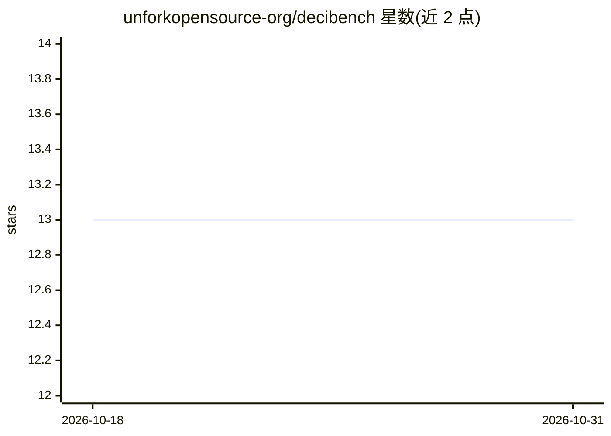

# unforkopensource-org/decibench

⭐ 13 · Python · NOASSERTION · 推送 2026-06-22 · [GitHub](https://github.com/unforkopensource-org/decibench) · [官网](https://unfork.in) · 组织维护

**语音 AI agent 测试评测工具：确定性+语义+RAG 评测**

面向语音 AI agent 的开源测试与评测 CLI（自称 pytest for voice agents）：用 YAML 编写场景（或从文档自动生成），合成来电音频调用 agent，转写回答后由 10 个内置评估器评分，覆盖延迟、WER/CER、幻觉、任务完成、合规、打断处理、静音、MOS/STOI 音频质量等；结果写入本地 SQLite，输出 CLI/HTML/JUnit 报告或 Vue 仪表盘。支持 WebSocket/HTTP/Process/ElevenLabs/Twilio 等连接器，LLM-as-Judge 兼容任意 OpenAI 式 API（含 ollama），另附 MCP server 供 AI 编码 agent 调用。零遥测，含 PII 脱敏；要求 Python 3.11+，macOS/Linux/WSL。

## 筛选速览

| 维度 | 判定 | 备注 |
|---|---|---|
| AI 角色 | `ai-ecosystem` | LLM/agent 周边工具 |
| 许可风险 | `none` | NOASSERTION |
| 部署形态 | `library` | 以包/库形式分发 |
| 模型依赖 | local-ok | 支持本地模型 |
| 硬件要求 | — | 无带数字的原话,不猜 |
| 安装摩擦 | `low` | 无编译、无系统依赖或容器化 |
| 成熟度 | — | 结构信号不足 |

## 能力要点

- 10 个内置评估器（延迟/WER/幻觉/合规/打断/MOS 等）
- 三种测试模式：deterministic（免费）/ semantic（LLM-as-Judge）/ semantic+rag（文档自动生成对抗测试套件）
- 10 种连接器接入 agent（WebSocket/HTTP/ElevenLabs/Twilio/Vapi 等），无需在 agent 内装 SDK
- 零遥测、PII 脱敏、密钥存 OS keyring、本地 SQLite 存储

## 适用场景

- 语音 agent 上线前测试延迟、幻觉与合规问题
- 从产品文档自动生成对抗性测试场景
- 敏感通话数据场景下的本地化评测与 CI 集成
- 用 AI 编码 agent 通过 MCP 直接运行并分析语音测试

## 场景标签

`模型评测` · 领域:评测与运维

## 证据(README 行号)

> L10:  The open testing standard for voice AI agents.
> L25: **Decibench fixes this.** It's `pytest` for voice agents.
> L38: 3. 10 evaluators score every call across latency, accuracy, compliance, and more

## 星数曲线

2026-10-18 13 → 2026-10-31 13（+0）

---
*卡片 v1 · prompt 1.4 · 生成 2026-10-31 · 置信度 high · 依据 README sha `d52bfa8cb697` · [字段定义](../../DATASET.md)*
