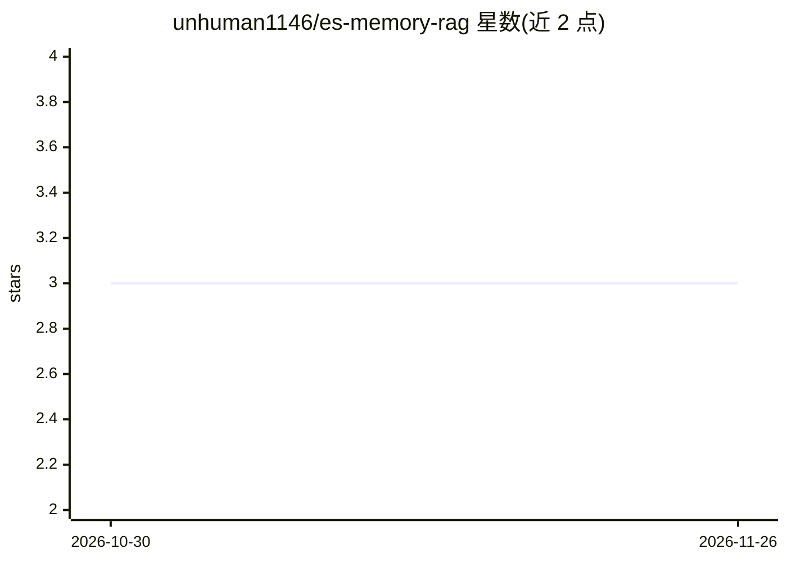

# unhuman1146/es-memory-rag

⭐ 3 · Python · MIT · 推送 2026-10-31 · [GitHub](https://github.com/unhuman1146/es-memory-rag) · [官网](https://github.com/unhuman1146/es-memory-rag) · 个人维护 · 中文 README

**为 Agent 管理长期记忆、情绪关联与上下文工作集的 Skill 包**

以 Agent Skill 包形式提供的长期记忆与上下文管理组件：RAG 层按当前话题筛选、重排并主动注入记忆；上下文工作集对近期对话、状态、摘要与工具结果分区换页；记忆权重随时间衰减，事实可压缩，低权重记忆受控遗忘，状态层永不压缩。宿主需自行实现 RAGAdapter 接线 embedding、索引与权限；参考引擎本身不做 embedding、rerank 或模型调用。安装方式为将整个目录复制进 Agent 的 skills 目录，Python 3.11+ 标准库零第三方依赖。

## 筛选速览

| 维度 | 判定 | 备注 |
|---|---|---|
| AI 角色 | `ai-ecosystem` | LLM/agent 周边工具 |
| 许可风险 | `permissive` | MIT |
| 部署形态 | `None` |  |
| 模型依赖 | — | README 未给出锁定关系 |
| 硬件要求 | — | 无带数字的原话,不猜 |
| 安装摩擦 | `low` | 无编译、无系统依赖或容器化 |
| 成熟度 | — | 结构信号不足 |

## 能力要点

- 上下文工作集分区换页，避免整段历史累加进模型请求
- 记忆权重衰减、有损压缩与受控遗忘，状态层永不压缩
- 注入时声明缺失（N 条相关记忆未加载）
- 286 项离线单测，另有需 embedding 凭据的真机演示脚本

## 适用场景

- 给 Agent 增加长期记忆与上下文工作集管理
- 替换简单堆历史式的上下文压缩方案
- 需要记忆可解释、可标定遗忘速度的 Agent 场景

## 场景标签

`Agent 记忆` · 领域:Agent 开发

## 证据(README 行号)

> L5: **英文名：ES-Mind。** ES-Mind 是原 ES-Memory RAG 的新品牌，为 Agent 管理长期记忆、情绪关联与上下文工作集；不宣称意识。`es-memory-rag` 仓库、目录、Skill name、导入、
> L13: **主打能力：RAG 长期记忆 + 上下文异构换页。** RAG 根据当前话题筛选、重排并主动注入记忆；上下文工作集将近期对话、状态、摘要、记忆和工具结果分区管理，按需换页，避免把整段历史一直累加到模型请求。
> L26: > **给 Agent 用：** 这是一个 Skill 包。把 `es-memory-rag/` 整个目录放进你的 Agent 的 skills 目录即可。

## 星数曲线

2026-10-30 3 → 2026-11-26 3（+0）

---
*卡片 v1 · prompt 1.4 · 生成 2026-11-21 · 置信度 high · 依据 README sha `94c5796d85fc` · [字段定义](../../DATASET.md)*
