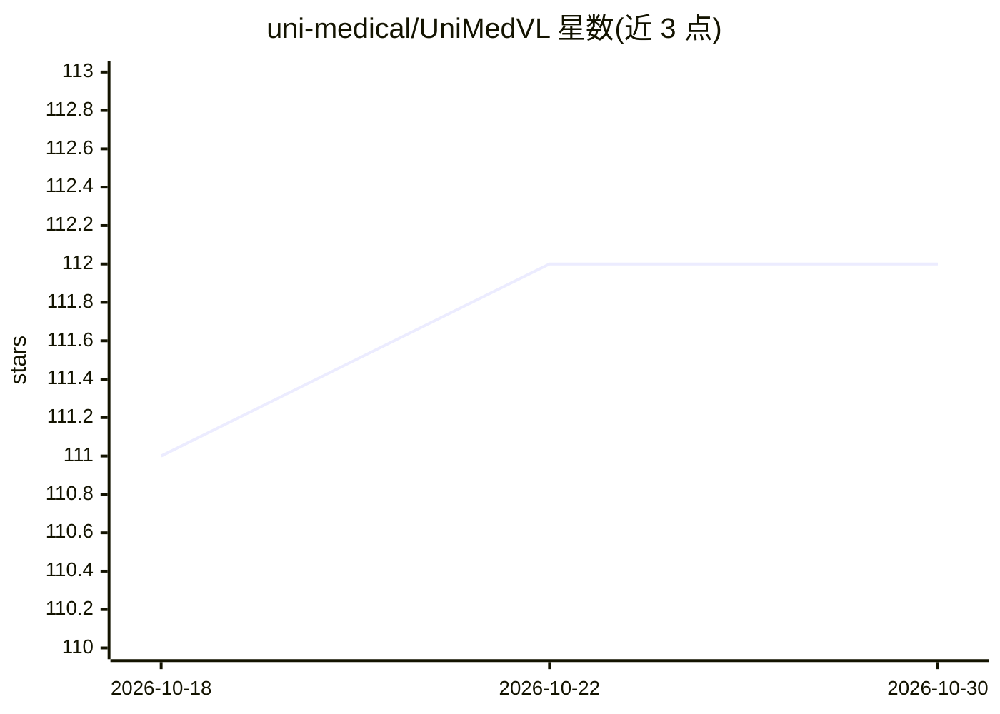

# uni-medical/UniMedVL

⭐ 112 · Python · Apache-2.0 · 推送 2026-07-30 · [GitHub](https://github.com/uni-medical/UniMedVL) · 组织维护

**医学多模态基础模型：单一 14B 检查点统一理解与生成**

UniMedVL 是 ICML 2026 论文的官方实现，为统一医学视觉-语言基础模型（14B 参数），采用 Observation-Knowledge-Analysis 三级架构，在单一检查点内支持医学 VQA、报告生成、文本到医学图像合成、跨模态翻译、虚拟染色等任务，覆盖 9 种成像模态。训练数据为 UniMed-5M（560 万+ 样本，三阶段质量验证）。仓库提供推理代码与 HuggingFace 检查点下载，conda 环境安装；训练代码尚未开源。Apache 2.0 许可。

## 筛选速览

| 维度 | 判定 | 备注 |
|---|---|---|
| AI 角色 | `ai-native` | 本体是模型或模型工具 |
| 许可风险 | `permissive` | Apache-2.0 |
| 部署形态 | `None` |  |
| 模型依赖 | — | README 未给出锁定关系 |
| 硬件要求 | — | 无带数字的原话,不猜 |
| 安装摩擦 | `low` | 无编译、无系统依赖或容器化 |
| 成熟度 | — | 结构信号不足 |

## 能力要点

- 单一 14B 检查点统一多模态理解与生成
- 覆盖 9 种医学成像模态（CXR/CT/MRI/超声/病理等）
- 基于 UniMed-5M 数据集（5.6M+ 样本）三阶段课程训练
- 提供交互式 VQA 与图像生成推理脚本

## 适用场景

- 医学影像视觉问答与诊断推理
- 自动生成医学影像报告
- 文本合成医学图像与跨模态翻译（如 H&E→IHC 虚拟染色）

## 场景标签

`图像生成` `图像视频处理` `多模态` · 领域:内容生成

## 证据(README 行号)

> L34:  A unified medical foundation model enabling both understanding and generation capabilities within a single archite
> L48: - **Versatile Medical Multimodal Capabilities:** UniMedVL supports a broad spectrum of medical tasks, including vis

## 星数曲线

2026-10-18 111 → 2026-10-30 112（+1）

---
*卡片 v1 · prompt 1.4 · 生成 2026-10-23 · 置信度 high · 依据 README sha `153bf7c12313` · [字段定义](../../DATASET.md)*
