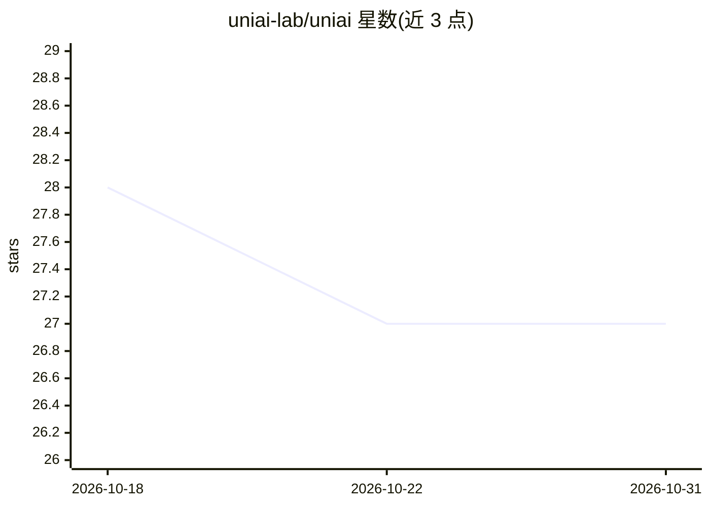

# uniai-lab/uniai

⭐ 27 · TypeScript · MIT · 推送 2026-01-30 · [GitHub](https://github.com/uniai-lab/uniai) · [官网](https://lechat.cas-ll.cn) · 组织维护 · 中文 README

**TypeScript 库：统一接口调用多家生成式 AI 模型**

面向开发者的 npm 库，将 OpenAI/GPT、Claude、Gemini、DeepSeek、文心一言、通义千问、MoonShot、讯飞星火、ChatGLM 等对话模型，以及 DALL-E、MidJourney Proxy、Stability AI 等图像模型聚合为统一输入输出接口。支持流式对话、图文/音频多模态输入、多 key 与代理配置，可经 Other provider 接入任意 OpenAI 兼容 API 或 Ollama 本地部署模型。附带 Prompt 类构建层级提示树并生成 Markdown，用 jest 跑单测。

## 筛选速览

| 维度 | 判定 | 备注 |
|---|---|---|
| AI 角色 | `ai-ecosystem` | LLM/agent 周边工具 |
| 许可风险 | `permissive` | MIT |
| 部署形态 | `library` | 以包/库形式分发 |
| 模型依赖 | local-ok | 支持本地模型 |
| 硬件要求 | — | 无带数字的原话,不猜 |
| 安装摩擦 | `low` | 无编译、无系统依赖或容器化 |
| 成熟度 | — | 结构信号不足 |

## 能力要点

- 统一接口封装 10+ 家对话模型与 3 类图像模型
- 支持流式输出、多 key、API 代理配置
- Other provider 可接入 OpenAI 兼容 API 与 Ollama 本地模型
- Prompt 类支持层级提示树并自动生成 Markdown

## 适用场景

- 在 TypeScript/JS 项目中切换多家 LLM 供应商而不改代码
- 用统一代码同时接入对话与图像生成模型
- 通过 OpenAI 兼容端点调用 Ollama 本地部署的模型

## 场景标签

`模型网关` · 领域:Agent 开发

## 证据(README 行号)

> L4: UniAI is a library integrated with multiple cutting-edge generative-AI models.
> L5: It provides a unified interface for different models, streamlining the development process by ensuring a consistent 

## 星数曲线

2026-10-18 28 → 2026-10-31 27（-1）

---
*卡片 v1 · prompt 1.4 · 生成 2026-10-26 · 置信度 high · 依据 README sha `dcb0ebbcac78` · [字段定义](../../DATASET.md)*
