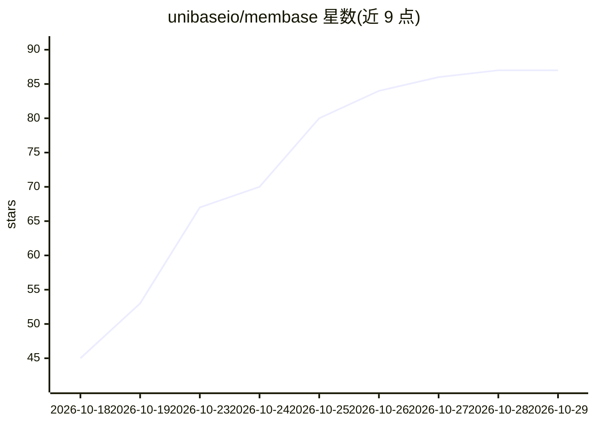

# unibaseio/membase

⭐ 87 · Python · MIT · 推送 2026-10-27 · [GitHub](https://github.com/unibaseio/membase) · [官网](https://membase.ai) · 组织维护

**AI agent 记忆层：统一记忆供多 AI 应用读写**

Unibase 公司开发的 AI agent 记忆基础设施：将事实、文档、网页与 Claude/ChatGPT 聊天导出汇入一份统一记忆，通过容器按项目隔离，支持搜索、提问与遗忘操作。开发者侧提供 Python/TypeScript SDK、membase CLI 与 MCP server；记忆可托管在 Membase 账户，或经 unibaseio-membase[local] 本地运行。Claude Code、Cursor、Codex、ChatGPT 等 MCP 客户端可读取同一记忆。仓库为专有许可（Proprietary）。

## 筛选速览

| 维度 | 判定 | 备注 |
|---|---|---|
| AI 角色 | `ai-ecosystem` | LLM/agent 周边工具 |
| 许可风险 | `none` | MIT |
| 部署形态 | `library` | 以包/库形式分发 |
| 模型依赖 | — | README 未给出锁定关系 |
| 硬件要求 | — | 无带数字的原话,不猜 |
| 安装摩擦 | `low` | 无编译、无系统依赖或容器化 |
| 成熟度 | — | 结构信号不足 |

## 能力要点

- 一份统一记忆，SDK/CLI/MCP 多端读写
- 支持导入 Claude/ChatGPT 聊天导出、网页与文档
- 托管与本地（[local]，Python 3.12/3.13）两种运行方式
- README 给出 LoCoMo 93.1%、LongMemEval_S 92.6% 的基准结果

## 适用场景

- 让多个 AI 工具（Claude Code、Cursor 等）共享同一份长期记忆
- 导入历史聊天记录并跨项目检索问答
- 为自研 agent 应用接入托管或本地记忆层

## 场景标签

`Agent 记忆` · 领域:Agent 开发

## 证据(README 行号)

> L20: Membase is the memory layer for AI agents. It keeps one memory for everything you and your agents
> L28: This repository is the developer side: Python and TypeScript clients, the `membase` command line
> L84:  MCP clients, hosted or local server, same tools

## 星数曲线

2026-10-18 45 → 2026-10-29 87（+42）

---
*卡片 v1 · prompt 1.4 · 生成 2026-10-24 · 置信度 high · 依据 README sha `0eb50617d7b4` · [字段定义](../../DATASET.md)*
