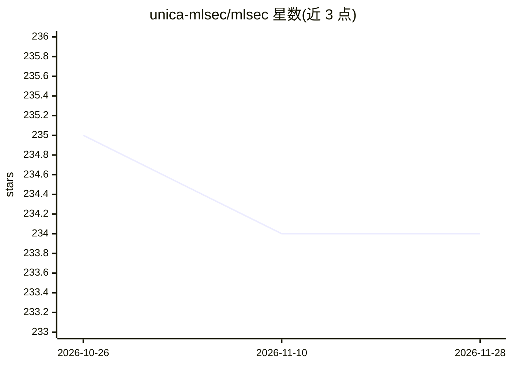

# unica-mlsec/mlsec

⭐ 234 · Jupyter Notebook · 推送 2026-11-27 · [GitHub](https://github.com/unica-mlsec/mlsec) · [官网](https://unica-mlsec.github.io/mlsec/) · 组织维护

**面向硕博生的机器学习安全课程资料库**

卡利亚里大学机器学习安全课程（2026-2027 学年）的教学材料仓库，由 Battista Biggio 教授主讲，面向计算机工程、网络安全与人工智能硕士及国家人工智能博士项目。内容覆盖威胁建模、逃逸攻击、投毒攻击与防御、认证防御、隐私攻击、可解释 AI、LLM 安全与 AI Agent 等主题。考核包含读书报告/口试与 Python 项目，学生需用 Python 在基准数据集上测试模型对抗鲁棒性。

## 筛选速览

| 维度 | 判定 | 备注 |
|---|---|---|
| AI 角色 | `ai-knowledge` | 知识聚合/清单类 |
| 许可风险 | `none` | — |
| 部署形态 | `None` |  |
| 模型依赖 | — | README 未给出锁定关系 |
| 硬件要求 | — | 无带数字的原话,不猜 |
| 安装摩擦 | `low` | 无编译、无系统依赖或容器化 |
| 成熟度 | — | 结构信号不足 |

## 能力要点

- 覆盖威胁建模、逃逸/投毒/隐私攻击与防御的课程讲义
- 包含 LLM 安全与 AI Agent 专题及客座讲座
- 考核含 Python 项目：测试模型对抗鲁棒性

## 适用场景

- 查找对抗机器学习课程讲义与课程材料
- 按课程大纲系统学习机器学习安全主题
- 参考其课程设计组织安全方向教学

## 场景标签

`教程课程` · 领域:学习与行业

## 证据(README 行号)

> L27: The objective of this course is to provide students
> L28: with the fundamental elements of machine learning security in the context of different application domains.

## 星数曲线

2026-10-26 235 → 2026-11-28 234（-1）

---
*卡片 v1 · prompt 1.4 · 生成 2026-11-27 · 置信度 high · 依据 README sha `47469c572eb2` · [字段定义](../../DATASET.md)*
