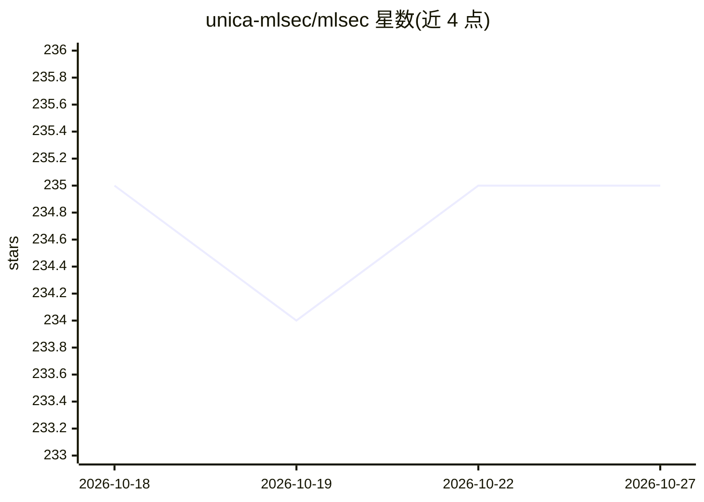

# unica-mlsec/mlsec

⭐ 235 · Jupyter Notebook · 推送 2026-10-01 · [GitHub](https://github.com/unica-mlsec/mlsec) · [官网](https://unica-mlsec.github.io/mlsec/) · 组织维护

**卡利亚里大学机器学习安全课程的教学资料仓库**

面向硕士与博士研究生的 Machine Learning Security 课程（2026-2027 学年，10 月开课）的 GitHub 材料仓库。课程内容覆盖对抗机器学习的威胁建模、逃逸攻击、投毒攻击与防御、隐私攻击与防御、认证防御、可解释 AI 与 AI Agent 等主题，考核方式为阅读小组/口试（占 2/3）与 Python 项目（占 1/3）。仓库提供课程讲义列表，用于配合课堂教学使用。

## 筛选速览

| 维度 | 判定 | 备注 |
|---|---|---|
| AI 角色 | `ai-knowledge` | 知识聚合/清单类 |
| 许可风险 | `none` | — |
| 部署形态 | `None` |  |
| 模型依赖 | — | README 未给出锁定关系 |
| 硬件要求 | — | 无带数字的原话,不猜 |
| 安装摩擦 | `low` | 无编译、无系统依赖或容器化 |
| 成熟度 | — | 结构信号不足 |

## 能力要点

- 课程涵盖威胁建模、逃逸/投毒/隐私攻击与防御、认证防御等主题
- 考核包含 Python 项目（占成绩 1/3）
- 面向 MSc 与国家 AI 博士项目的学生

## 适用场景

- 按讲义列表学习对抗机器学习的攻击与防御方法
- 作为机器学习安全课程的配套材料
- 了解课程考核与评分安排

## 场景标签

`教程课程` · 领域:学习与行业

## 证据(README 行号)

> L1: ## Machine Learning Security
> L27: The objective of this course is to provide students

## 星数曲线

2026-10-18 235 → 2026-10-27 235（+0）

---
*卡片 v1 · prompt 1.4 · 生成 2026-10-22 · 置信度 high · 依据 README sha `a13afabb8edb` · [字段定义](../../DATASET.md)*
