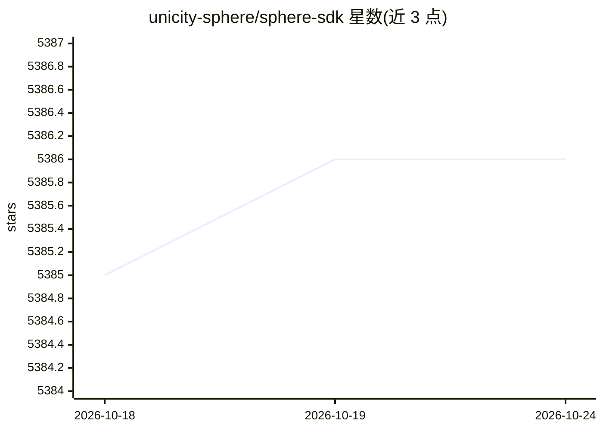

# unicity-sphere/sphere-sdk

⭐ 5,386 · TypeScript · MIT · 推送 2026-10-20 · [GitHub](https://github.com/unicity-sphere/sphere-sdk) · [官网](https://unicity.ai) · 组织维护

**给自主经济 Agent 提供钱包、支付与协商能力的 TypeScript SDK**

模块化 TypeScript SDK，封装 Unicity 状态转移网络的钱包操作：BIP39/BIP32 密钥派生、经 wallet-api 通道的引擎认证代币转账（服务端保管库存、密钥留在本地）、支付请求、签名意向公告板、基于 Nostr 的 DM 与群组消息，以及 dApp 与钱包间的 Connect 通信协议。支付与消息分离：Nostr 仅承载消息，资金走 wallet-api。SDK 还定义了 send() 拒绝时的资金安全语义（不可重复发送、自动恢复）。面向构建自主经济 Agent 的开发者。限制：CLI 未发布到 npm，浏览器实现暂无类型声明。

## 筛选速览

| 维度 | 判定 | 备注 |
|---|---|---|
| AI 角色 | `ai-ecosystem` | LLM/agent 周边工具 |
| 许可风险 | `permissive` | MIT |
| 部署形态 | `library` | 以包/库形式分发 |
| 模型依赖 | — | README 未给出锁定关系 |
| 硬件要求 | — | 无带数字的原话,不猜 |
| 安装摩擦 | `low` | 无编译、无系统依赖或容器化 |
| 成熟度 | — | 结构信号不足 |

## 能力要点

- BIP39/BIP32 钱包管理与 HD 多地址派生
- 经 wallet-api 的引擎认证转账，密钥不出本地
- 签名意向公告板（语义搜索+实时流）与 Nostr 消息
- 支付失败的资金安全语义与同 transferId 自动恢复

## 适用场景

- 为自主 agent 接入钱包身份与链上支付
- 构建 agent 间支付请求与意向撮合应用
- 通过 Connect 协议做 dApp 与托管钱包通信

## 场景标签

 · 领域:区块链/Agent 经济基础设施

## 证据(README 行号)

> L3: A modular TypeScript SDK for Unicity wallet operations (Unicity state transition network).
> L8: - **Payments** - Engine-certified token transfers over the **wallet-api vertical** (durable server-side intents, mai

## 星数曲线

2026-10-18 5,385 → 2026-10-24 5,386（+1）

---
*卡片 v1 · prompt 1.4 · 生成 2026-10-20 · 置信度 mid · 依据 README sha `1c84a2a575e9` · [字段定义](../../DATASET.md)*
