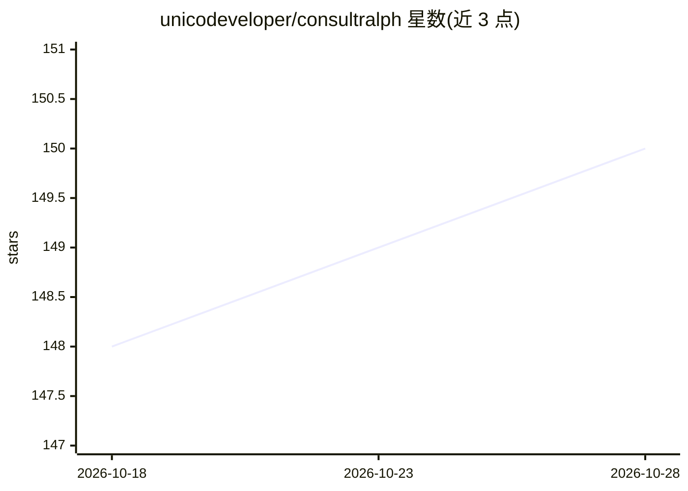

# unicodeveloper/consultralph

⭐ 150 · TypeScript · 推送 2026-04-20 · [GitHub](https://github.com/unicodeveloper/consultralph) · [官网](https://consultralph.com) · 个人维护

**面向咨询顾问的自主深度研究 AI 代理，生成尽调与市场报告**

基于 Next.js 15 构建的 Web 应用：输入研究主题后调用 Valyu Deep Research API 执行自主深度研究，5-10 分钟内产出 PDF 报告、CSV 数据表、DOCX 摘要与 PPTX 幻灯片，支持公司尽调、市场分析、竞争格局、行业概览与自定义研究五类任务。面向 EY、Deloitte、McKinsey 等咨询公司的顾问与分析师。提供自托管（单一 API key）与 Valyu OAuth 两种部署模式，依赖外部 Valyu API key 才能运行。

## 筛选速览

| 维度 | 判定 | 备注 |
|---|---|---|
| AI 角色 | `ai-native` | 本体是模型或模型工具 |
| 许可风险 | `none` | — |
| 部署形态 | `self-host` | docker 或自建部署 |
| 模型依赖 | — | README 未给出锁定关系 |
| 硬件要求 | — | 无带数字的原话,不猜 |
| 安装摩擦 | `low` | 无编译、无系统依赖或容器化 |
| 成熟度 | — | 结构信号不足 |

## 能力要点

- 自主深度研究代理，输出 PDF/CSV/DOCX/PPTX 四种交付物
- 五种研究类型：公司尽调、市场分析、竞争格局、行业概览、自定义
- 自托管与 Valyu OAuth 两种部署模式
- 可并行运行多个研究任务

## 适用场景

- 顾问快速生成并购标的公司的尽调报告
- 为管理层汇报生成一页纸摘要与客户演示幻灯片
- 完成市场规模测算与竞争格局梳理

## 场景标签

`科研工具` `AI 写作` · 领域:内容生成

## 证据(README 行号)

> L5: **Consult Ralph** is an autonomous deep research AI agent for consultants and analysts. It generates comprehensive d
> L33: - **Deep AI Research** - Leverages Valyu's Deep Research API to search across thousands of sources

## 星数曲线

2026-10-18 148 → 2026-10-28 150（+2）

---
*卡片 v1 · prompt 1.4 · 生成 2026-10-22 · 置信度 high · 依据 README sha `8504a2394c56` · [字段定义](../../DATASET.md)*
