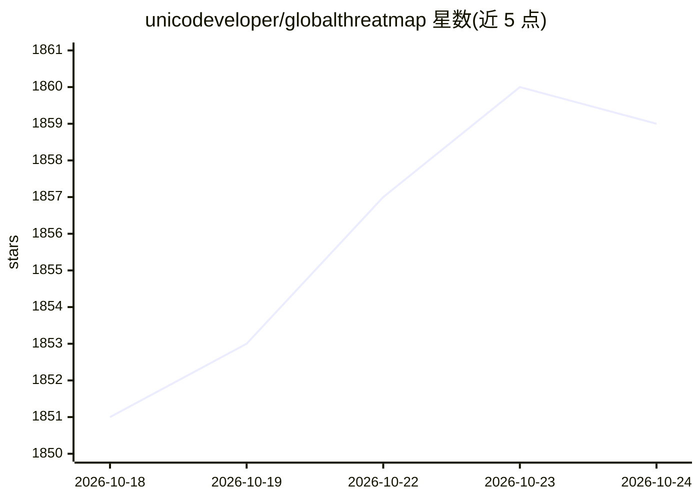

# unicodeveloper/globalthreatmap

⭐ 1,859 · TypeScript · 推送 2026-07-02 · [GitHub](https://github.com/unicodeveloper/globalthreatmap) · [官网](https://globalthreatmap.up.railway.app) · 个人维护

**全球威胁与事件情报地图：实时安全事件与深度研究简报**

基于 Next.js 的实时态势感知 Web 平台，在 Mapbox 暗色地图上绘制全球安全事件（冲突/抗议/灾害，按威胁等级配色）、美军及北约军事基地、国家冲突情报（现役与历史）。通过 Valyu 的 Search/Answer/Deep Research API 合成带引用的分析，可对任意实体生成约 50 页情报报告及 CSV/PowerPoint/PDF 导出。需自备 Mapbox token 与 Valyu API key，OpenAI key 可选用于位置提取；支持 self-hosted 与 Valyu OAuth 两种模式，可部署到 Railway。

## 筛选速览

| 维度 | 判定 | 备注 |
|---|---|---|
| AI 角色 | `ai-native` | 本体是模型或模型工具 |
| 许可风险 | `none` | — |
| 部署形态 | `library` | 以包/库形式分发 |
| 模型依赖 | — | README 未给出锁定关系 |
| 硬件要求 | — | 无带数字的原话,不猜 |
| 安装摩擦 | `low` | 无编译、无系统依赖或容器化 |
| 成熟度 | — | 结构信号不足 |

## 能力要点

- 实时事件地图：威胁等级配色、聚类与热力图视图
- Valyu Deep Research 生成约 50 页情报报告，支持 CSV/PPT/PDF 导出
- 国家冲突情报：历史与当前冲突分页展示并附引用来源（排除 Wikipedia）
- 美军与北约军事基地图层及关键词/威胁等级告警系统

## 适用场景

- OSINT 分析师追踪全球冲突与安全事件
- 对国家、武装组织或人物生成可导出的情报简报
- 监控特定关键词或威胁等级的实时告警

## 场景标签

`网络安全` · 领域:学习与行业

## 证据(README 行号)

> L25: - **AI-Powered Analysis** - Conflict data synthesized using Valyu Answer API with cited sources
> L128: Build comprehensive intelligence dossiers on any actor using Valyu's Deep Research API. Enter any entity - nations
> L135: Reports take 5-10 minutes to generate but are extremely detailed and comprehensive, pulling from hundreds of sourc

## 星数曲线

2026-10-18 1,851 → 2026-10-24 1,859（+8）

---
*卡片 v1 · prompt 1.4 · 生成 2026-10-21 · 置信度 high · 依据 README sha `024b5d50513d` · [字段定义](../../DATASET.md)*
