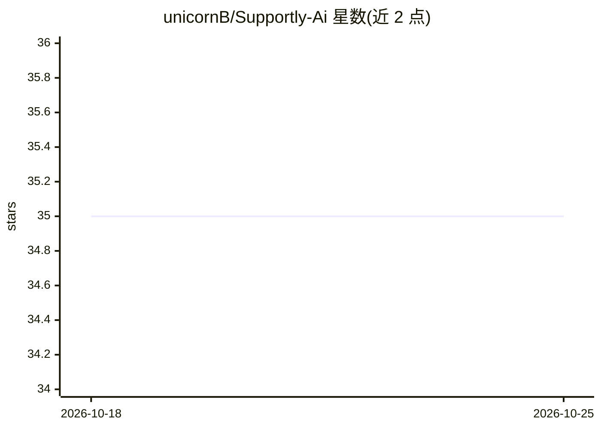

# unicornB/Supportly-Ai

⭐ 36 · TypeScript · 推送 2026-05-23 · [GitHub](https://github.com/unicornB/Supportly-Ai) · 个人维护 · 中文 README

**给小团队自部署的 Cloudflare 原生 AI 智能客服后端**

基于 Cloudflare Workers 运行时的单实例智能客服后端：把 Web Chat Widget、Telegram Bot、自定义 Webhook 汇入统一会话与消息表，提供 Admin 后台、知识库上传与 AI Search 同步、Workers AI 自动回复（引用展示、无命中不强行编造）、人工接管、图片/视频消息（R2 存储）。全部依赖 Cloudflare 产品（Workers/D1/R2/AI Search/Workers AI/Durable Objects），不依赖外部数据库或模型网关。项目代码免费、不内置坐席/会话限制，第三方 Cloudflare 资源按平台规则计费。需 Node.js 20+ 与 pnpm，通过 wrangler 部署。当前为单实例 MVP，多租户/客服分配等未实现。

## 筛选速览

| 维度 | 判定 | 备注 |
|---|---|---|
| AI 角色 | `ai-enhanced` | 去掉 AI 部分产品仍成立 |
| 许可风险 | `none` | — |
| 部署形态 | `library` | 以包/库形式分发 |
| 模型依赖 | — | README 未给出锁定关系 |
| 硬件要求 | — | 无带数字的原话,不猜 |
| 安装摩擦 | `low` | 无编译、无系统依赖或容器化 |
| 成熟度 | `idea` | |

## 能力要点

- 知识库 + Cloudflare AI Search 检索 + Workers AI 生成的自动回复，含引用展示
- 渠道统一抽象为 ChannelAdapter，已实现 web_chat/telegram/custom_webhook
- 图片/视频消息走 R2 存储 + Worker 鉴权读取，支持视频 Range 播放
- AI 回复在 Worker waitUntil 后台任务生成，经 WebSocket 实时推送

## 适用场景

- 用自己的 Cloudflare 账号自部署一套在线客服系统
- 通过知识库驱动 AI 自动回复并保留人工接管
- 把网站聊天挂件和 Telegram Bot 汇入统一客服会话
- 在 uni-app App/小程序/H5 中接入无 UI 客服聊天 SDK

## 场景标签

`聊天机器人` `知识库管理` · 领域:对话与助手

## 证据(README 行号)

> L188:   -> Workers AI 生成回答
> L220: - [x] Bot / 人工接管切换

## 星数曲线

2026-10-18 35 → 2026-10-25 35（+0）

---
*卡片 v1 · prompt 1.4 · 生成 2026-10-25 · 置信度 mid · 依据 README sha `7b7bbcae3316` · [字段定义](../../DATASET.md)*
