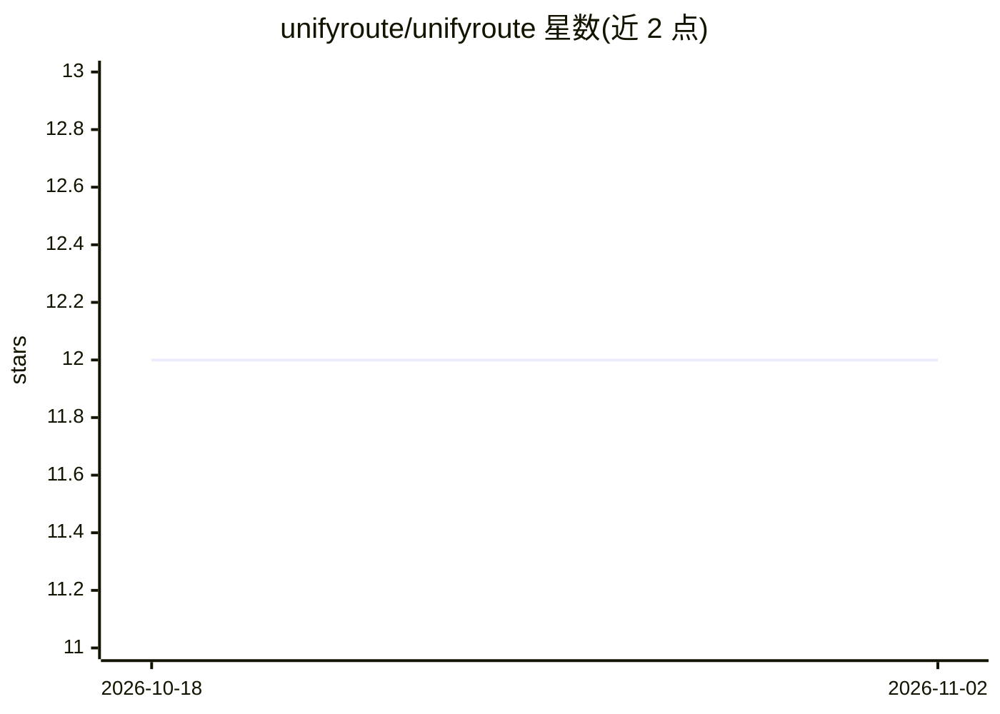

# unifyroute/unifyroute

⭐ 12 · Python · Apache-2.0 · 推送 2026-05-04 · [GitHub](https://github.com/unifyroute/unifyroute) · [官网](https://www.unifyroute.com) · 组织维护

**自托管 OpenAI 兼容多 LLM 提供商路由网关**

基于 FastAPI 的自托管 API 网关：将请求路由到多个 LLM 提供商，提供层级化路由、故障转移、配额感知与凭据管理，并暴露 OpenAI 兼容端点（chat/completions、completions、models）供现有 SDK/工具直接接入。内置管理 Dashboard（localhost:6565）用于凭据、提供商管理及成本与用量可见性。提供一键安装脚本（自动装 Python/uv/Node.js）与手动 git clone 部署两条路径，支持 Linux/macOS/Windows。Apache 2.0 许可。

## 筛选速览

| 维度 | 判定 | 备注 |
|---|---|---|
| AI 角色 | `ai-ecosystem` | LLM/agent 周边工具 |
| 许可风险 | `permissive` | Apache-2.0 |
| 部署形态 | `None` |  |
| 模型依赖 | — | README 未给出锁定关系 |
| 硬件要求 | — | 无带数字的原话,不猜 |
| 安装摩擦 | `low` | 无编译、无系统依赖或容器化 |
| 成熟度 | — | 结构信号不足 |

## 能力要点

- OpenAI 兼容 API 端点，现有 SDK/工具可直接接入
- 层级化路由、故障转移与提供商冗余
- Dashboard 管理凭据/提供商，展示成本与用量
- 一键安装脚本覆盖 Linux/macOS/Windows

## 适用场景

- 统一接入多个 LLM 提供商并自动故障转移
- 在多个 SDK/工具间共用一套 OpenAI 兼容网关
- 生产环境管控配额与查看成本用量

## 场景标签

`模型网关` · 领域:Agent 开发

## 证据(README 行号)

> L7: UnifyRoute is a self-hosted, OpenAI-compatible gateway for routing requests across multiple LLM providers with failo
> L13: - OpenAI-compatible API endpoints for easy SDK/tool integration.

## 星数曲线

2026-10-18 12 → 2026-11-02 12（+0）

---
*卡片 v1 · prompt 1.4 · 生成 2026-10-31 · 置信度 high · 依据 README sha `a3cf85c7a57d` · [字段定义](../../DATASET.md)*
