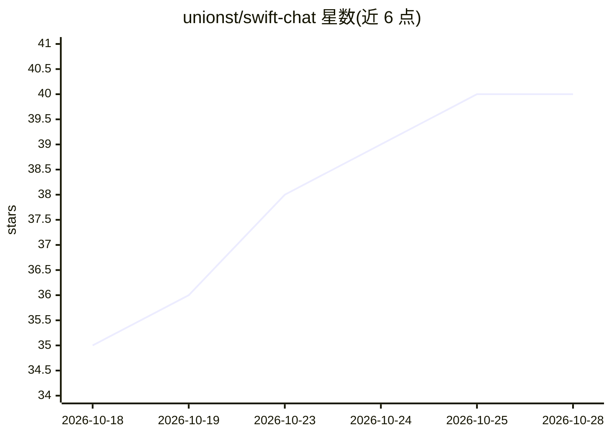

# unionst/swift-chat

⭐ 41 · Swift · NOASSERTION · 推送 2026-10-27 · [GitHub](https://github.com/unionst/swift-chat) · [官网](https://unionst.com/swiftchat) · 组织维护

**给 iOS 开发者的 SwiftUI 聊天 UI 组件库，支持 AI 助手流式对话**

以 SwiftUI 视图形式提供的聊天界面组件：底层用 UIKit collection view 实现，暴露 SwiftUI API。覆盖气泡分组、输入状态、送达/已读回执、照片与文件附件、Tapback 反应、回复引用、键盘交互与分页加载。通过 .chatStyle(.assistant) 修饰符切换为 ChatGPT 风格布局：问题上浮、回复以纯文本流式呈现。面向 iOS 聊天应用与 AI 助手应用开发者，以 Swift Package 形式安装，无自身包依赖；要求 iOS 18+ 与 Xcode 26.1+。

## 筛选速览

| 维度 | 判定 | 备注 |
|---|---|---|
| AI 角色 | `ai-ecosystem` | LLM/agent 周边工具 |
| 许可风险 | `none` | NOASSERTION |
| 部署形态 | `None` |  |
| 模型依赖 | — | README 未给出锁定关系 |
| 硬件要求 | — | 无带数字的原话,不猜 |
| 安装摩擦 | `low` | 无编译、无系统依赖或容器化 |
| 成熟度 | — | 结构信号不足 |

## 能力要点

- 单一 SwiftUI 视图提供完整聊天界面（气泡、回执、附件、打字指示器）
- .chatStyle(.assistant) 切换为 AI 助手风格：问题上浮、回复流式 Markdown 呈现
- 分页加载旧消息、消息驱逐回调与主线程卡顿监控
- 无包依赖，二进制自带所需内容

## 适用场景

- 为 iOS 聊天应用快速接入 iMessage 风格的完整聊天界面
- 构建 ChatGPT 风格的 AI 助手应用并展示流式回复
- 在长对话线程中做分页加载与性能管理

## 场景标签

 · 领域:移动端 UI 组件/聊天界面

## 证据(README 行号)

> L9: Swift Chat is a drop-in SwiftUI chat UI for iOS, for messaging apps and for ChatGPT-style AI assistants. Hand it you
> L11: Building an AI chat app? One modifier, `.chatStyle(.assistant)`, turns the same view into the layout Siri and ChatG
> L27: - **An assistant style** for AI threads: your question rises to the top and the answer streams in beneath it as bar

## 星数曲线

2026-10-18 35 → 2026-10-28 40（+5）

---
*卡片 v1 · prompt 1.4 · 生成 2026-10-25 · 置信度 high · 依据 README sha `1bc6d511b7a7` · [字段定义](../../DATASET.md)*
